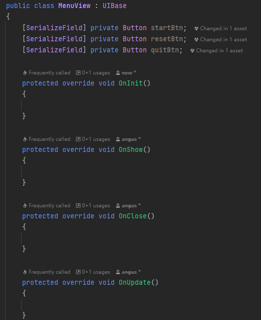
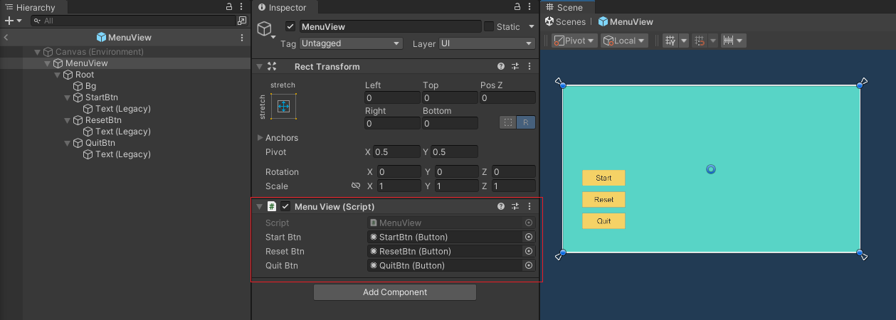
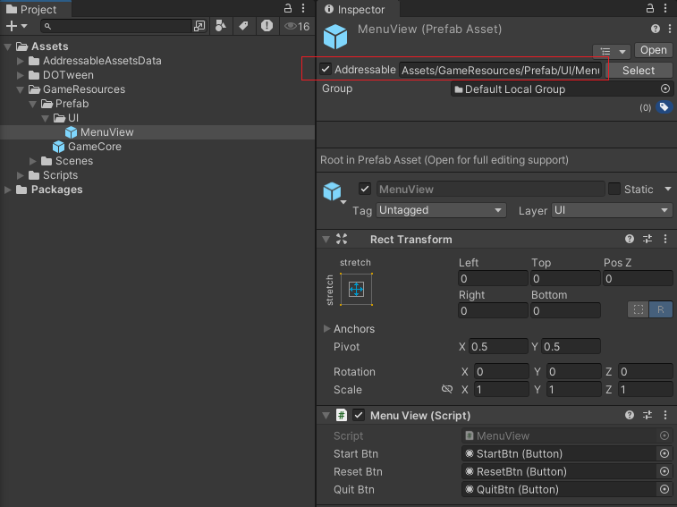
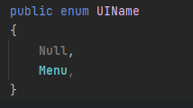
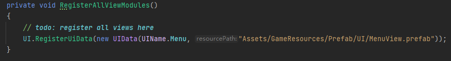
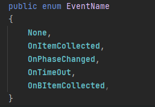
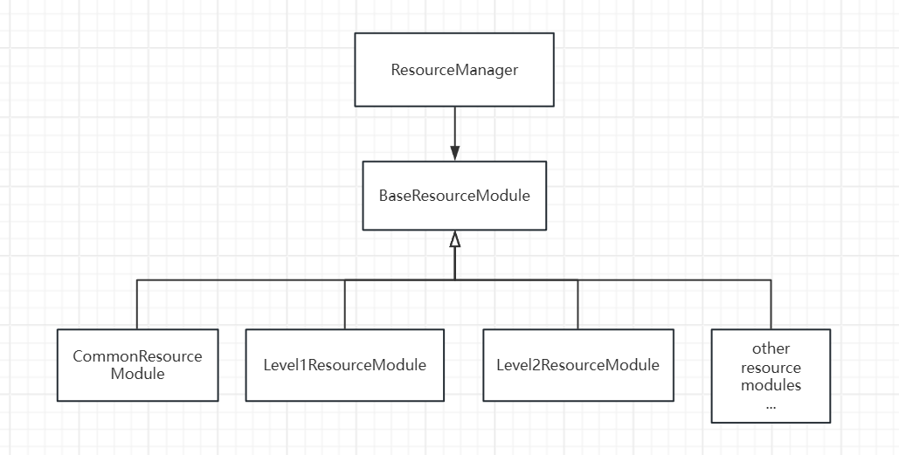
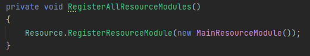
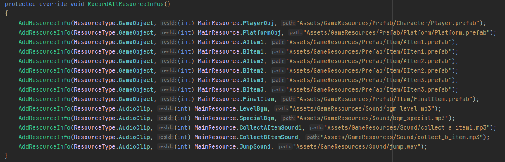

# 01 UIManager

To add a new ui:

Each active, enabled, shown view receives its update from Unity through `UIBase.Update()` and its `OnUpdate()` hook. Do not call a view's `Update()` manually. `UIManager.OnUpdate()` starts pending opens and cleans records whose instances were externally destroyed.

Duplicate opens share a pending load; once open, they synchronously return the existing view without calling `OnInit` or `OnShow` again. The first request determines the layer and data. An accepted callback receives the view on success or `null` on failure/cancellation; callbacks targeting destroyed Unity objects are skipped. Always handle `null`.

`CloseUI` cancels queued/loading requests as well as closing visible views; late results are released. `IsOpen` includes queued/loading requests and does not mean the view is visible. `CloseAll` closes requests present at the start of the call; requests explicitly opened by close hooks/callbacks are new requests and survive.

Use `OnInit` for references, `OnShow` to subscribe, and `OnClose` to unsubscribe. `OnClose` also cleans a partially completed `OnShow`, so cleanup must tolerate partial setup. Managed `Close()`, `Release()`, and `CloseSelf()` all close the owning request and release its instance. If overriding `OnDestroy`, call `base.OnDestroy()` after your own cleanup. Closing releases the instance; this is not a window pool.

1. create a ui script derived from `UIBase` class which provides basic lifecycle methods.
	
2. create a ui prefab and attach the ui script to it.
	
3. make sure the Addressable button on the ui prefab is toggled
	
4. add a name for the new ui in `UIName.cs`
	
5. register the new ui in `UIManager.Init()` using `RegisterUiData`.
	

Then, in logic code, we can use these APIs to control the ui:
```
// open Menu panel at first layer
GameCore.UI.OpenUI(UILayer.First, UIName.Menu, callback: view =>
{
    if (view == null) return; // failed or cancelled
    // The view is initialized and shown.
});

// close Menu panel
GameCore.UI.CloseUI(UIName.Menu);

// close all panels
GameCore.UI.CloseAll();

// fade out and fade in
GameCore.UI.TransitionFadeOut(() =>
{
	// load new scene and resources and balabala... 
	GameCore.UI.TransitionFadeIn();
});
```

# 02 EventManager
Every event should has a name in `EventName.cs`

`DispatchNow` notifies a snapshot of listeners in registration order. Subscribing or unsubscribing during a callback affects subsequent dispatches, including nested dispatches, while the current snapshot remains unchanged. Repeated registrations are retained; one `UnRegisterEvent` removes one registration.

`Dispatch` queues a notification for the next `GameCore` event update. Notifications added during that update wait for the following update. Re-entering `OnUpdate` from a callback does not flush them early. Each listener exception is logged and the remaining notifications continue; use ordinary methods for operations that must return success or failure.



Then, in logic code, we can use events through these APIs:
```
// register event
GameCore.Event.RegisterEvent(EventName.OnPhaseChanged, OnPhaseChanged);

// unregister event
GameCore.Event.UnRegisterEvent(EventName.OnPhaseChanged, OnPhaseChanged);

// broadcast event
GameCore.Event.DispatchNow(this, EventName.OnPhaseChanged);
```

# 03 ResourceManager



ResourceManager registers resource modules in `ResourceManager.Init()`.

A resource module owns its group's Addressables handles; callers borrow assets until `UnloadResources()`. Concurrent `LoadResources` calls share one batch, and an already-ready module reports success synchronously. Assets are available only after the whole group succeeds. `GetRes<T>` returns the default value when unavailable or when the type does not match.

The existing success callback remains valid. Supply the optional second callback to handle failure or cancellation:

```csharp
module.LoadResources(
    loadedCallback: () => { /* use the prepared group */ },
    failedCallback: () => { /* failed or unloaded before completion */ });

// After every borrower has finished (and dependent instances are destroyed):
module.UnloadResources();
```

Unload invalidates the batch immediately. Pending operations release their own late results without affecting a replacement batch. It cancels the whole group, not one borrower's subscription. Derived unload hooks must call `base.UnloadResources()`.

Direct `LoadAssetAsync<T>` calls transfer the returned handle to the caller. Release that exact holding with `Release(handle)` after use, including failure; do not release both the asset and its handle. Handle copies do not add ownership. `InstantiateGameObjectAsync` transfers its operation to a live completion callback (including static methods); the receiver must eventually call `ReleaseInstance(handle)`. If there is no callback, or its directly bound Unity target is destroyed, the helper releases the result. A callback that throws still owns the operation; the helper logs the exception without notifying twice or releasing a handle the receiver may have retained.



Every resource module registers its own resources at its method `RecordAllResourceInfos()`



Then, we can get access to resources like this:
```
// get a resource module from the ResourceManager
var resourceModule = GameCore.Resource.GetResourceModule<MainResourceModule>(ResourceModuleName.Main);

// get a resource from resource the module
var playerPrefab = resourceModule.GetRes<GameObject>(MainResource.PlayerObj);

// use the resource
var playerObj = Instantiate(playerPrefab);
...
```

# 04 SceneManager
```
GameCore.Scene.LoadSceneAsync("Assets/GameResources/Scenes/MenuScene.scene").Completed += handle =>  
{  
    if (handle.Status != AsyncOperationStatus.Succeeded)  
    {
	    return;  
    }
    
	// init the scene...
};
```

# 05 SoundManager

Use `SoundLayer` from the `Sound` namespace. Call these after GameCore has prepared its services.

```csharp
// A one-shot sound: volume = 1, pitch = 1, loop = false.
GameCore.Sound.PlaySound(SoundLayer.UI, clickClip);

// Looping music must be explicit; source settings are not inherited from a prior play.
GameCore.Sound.Play(SoundLayer.Background, bgmClip, bgmVolume, 1f, true);

GameCore.Sound.PauseSound(SoundLayer.Background);
// New requests on this paused layer are dropped, not queued.
GameCore.Sound.PlaySound(SoundLayer.Background, anotherClip);
GameCore.Sound.UnPauseSound(SoundLayer.Background);

// Stops all current voices and clears their clip references.
GameCore.Sound.StopSound(SoundLayer.Background);
```

Each SourceAgent has a `Max Sources` setting, default 16. Existing sources remain;
this limit controls dynamic expansion. Busy or paused layers drop new requests
without stealing voices. `StopSound` preserves the layer's pause state; call
`UnPauseSound` to allow future playback again. Pausing gameplay layers does not
pause the UI layer automatically.

Reused sources reset clip, loop, pitch and volume. Expanded sources copy the first
valid source's mixer, spatial and listener configuration. During
`AudioListener.pause`, only sources with `ignoreListenerPause` can be used or
expanded from. Missing layer configuration logs a warning and skips the operation.

Prefer the layer API. The existing low-level `GetAudioSource()` may return null:

```csharp
var source = sourceAgent.GetAudioSource();

if (source != null)
{
    source.clip = clip;
    source.volume = 0.5f;
    source.Play();
}
```

Use a borrowed source immediately; it is not a reserved or persistent playback
handle. Direct native Pause, PlayDelayed and PlayScheduled bypass the layer's
pause guarantees. For direct agent usage, `sourceAgent.Play(clip)` returns whether
the request was accepted, not whether it was audible on the output device.
AudioClip loading and release remain the caller/resource module's responsibility:
stop its playback before releasing the owning resource module. This API does not
automatically stop a layer on scene changes or persist user volume settings.
