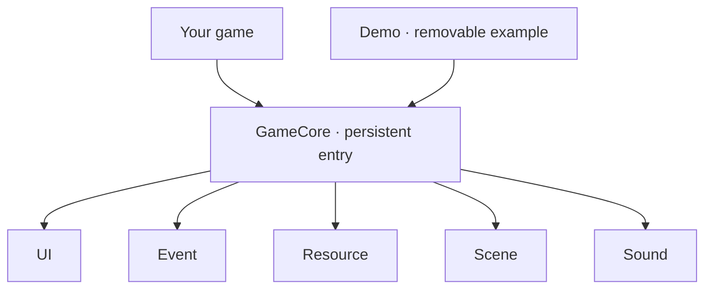

# MinimalUnityGameFramework

English · [简体中文](README.zh-CN.md)

**Version:** v0.5.0 (Local Excel config) · **Unity:** 6.6 (6000.6.5f1, not LTS)

[Download v0.5.0 (ZIP)](https://github.com/AngusK97/MinimalUnityGameFramework/archive/refs/tags/v0.5.0.zip) · [Quick start](docs/quick-start.md)

These guides match **v0.5.0**. See the [release notes](https://github.com/AngusK97/MinimalUnityGameFramework/releases/tag/v0.5.0) and [migration steps](Build-in%20Managers%20Usage.md). Keep downloaded code and guides together.

Hello there ~ I'm Angus, a game developer.

I made this small framework to take care of UI, events, resources, scenes and audio in my games, and wanted to share it with you. I hope it saves you some repeated work and leaves more time for your own gameplay.

> **Simple is beautiful.** Easy to start, easy to understand, easy to change.

<a id="philosophy"></a>

## 01 Philosophy

A few ideas guide how I build it:

- **Keep everyday work straightforward.** Configuration should be easy to edit, and features easy to call.
- **Make the flow easy to follow.** Say when initialization, loading and cleanup happen, and which code handles each.
- **Edit each configuration in one place.** Change the source; let tools generate code and runtime data.
- **Use the right existing tools.** Inspector for component settings, sheets for bulk configuration, ordinary C# for game logic.
- **Add things when you need them.** Start with gameplay code in your own game. Move it into shared code when you need it again.

<a id="the-big-picture"></a>

## 02 The big picture

**GameCore** provides five services and stays alive across scene changes. Your game and the removable Demo use the same API.

For configuration: **edit a table → Update Config → generated code and data → your game**. Start with local Excel; choose Google Sheets when your team needs shared editing. The running game reads the generated data, without a network connection.



**Prepare services → Load config and register content → Open the first screen → Run the game.**

UI loads windows through Resource. Scene coordinates loading, fades and UI cleanup. When you are ready to connect your own game, follow [Core](docs/core.md) to set up startup and cleanup.

<a id="pick-the-module-you-need"></a>

## 03 Pick the module you need

New here? Follow [Quick start](docs/quick-start.md) to play the Demo and make your first window. Then pick a guide below for what you want to add. [Config setup](docs/config-setup.md) covers choosing and switching sources.

| I want to… | Guide | Entry |
| --- | --- | --- |
| Set up shared services | [Core](docs/core.md) | `GameCore.IsReady` |
| Open or close a window | [UI](docs/ui.md) | `GameCore.UI` |
| Edit and read configuration | [Config tables](docs/config.md) | **Update Config** → `GameConfig.LoadAndRegister()` |
| Define windows | [UI tables](docs/ui-tables.md) | `UI` tab → `UIName.Shop` |
| Send a notification | [Events](docs/events.md) | `GameCore.Event` |
| Load and release assets | [Resources](docs/resources.md) | `GameCore.Resource` |
| Define shared assets | [Resource tables](docs/resource-tables.md) | `Resource` tab → `MainResources` |
| Define and change scenes | [Scenes](docs/scenes.md) | `Scene` tab → `SceneName.Menu` |
| Play a sound | [Audio](docs/audio.md) | `GameCore.Sound` |

<a id="where-things-belong"></a>

## 04 Where things belong

Keep the shared framework in Framework. Keep your scenes, scripts, source settings and generated data together in your own game folder so they are easy to find. Existing projects can follow [migration notes](Build-in%20Managers%20Usage.md).

```text
Assets/
├── Framework/
│   ├── Scripts/       Shared framework code
│   ├── Prefabs/       Shared Core prefab
│   └── Scenes/        Services-only InitScene
└── GameContent/
    ├── Demo/          Complete, removable teaching game
    └── MyGame/        Your scenes, content, source settings and generated data
```

Start reading the Demo at [DemoGame.cs](Assets/GameContent/Demo/Scripts/DemoGame.cs), [Demo.xlsx](Assets/GameContent/Demo/Editor/Tables/Source/Demo.xlsx) or [MenuView.cs](Assets/GameContent/Demo/Scripts/UI/MenuView.cs). Choose Demo in **Framework → Config** before your first table edit. After that, save Demo.xlsx and click **Update Config**. Once your own game runs, you can [delete the whole Demo](docs/quick-start.md#03-remove-the-demo).

<a id="try-it"></a>

## 05 Try it

The Demo includes its Excel workbook and generated data. You can edit and play locally without a Google account.

1. Open the repository root in Unity Hub with the Editor version above. Wait for import and compilation.
2. Open `Assets/GameContent/Demo/Scenes/DemoStart.unity` and press Play.
3. Choose **Start**, then move the blue cube to GOAL with **WASD / arrow keys**.


**Play again** restarts; **Menu** returns; **Settings / Escape** opens volume settings.

**Next: [create your first window](docs/quick-start.md)** · [Build your game](docs/build.md)

<a id="environment--scope"></a>

## 06 Environment & scope

Addressables **2.11.2** · uGUI **2.6.0** · Built-in rendering · old Input Manager.

The download and guides above use **v0.5.0**, with local Excel as the default config source and Google Sheets as an option. `0.x` APIs may change. Existing games can keep their pinned version and its bundled guides. See [Editor upgrades](docs/upgrading.md), [older API migration](Build-in%20Managers%20Usage.md) and [what has been verified](docs/build.md#04-verification-scope).

For gameplay settings, use the Inspector or your game's own ScriptableObjects. Text/localization and sound-playback tables are not included yet; you can already register AudioClip assets in the resource table. Add saves, full-game pause and platform input as your game needs them, and test on the platforms you plan to release for.

---

If you get stuck, I'd like to hear where: **anguskungcn@foxmail.com**.
