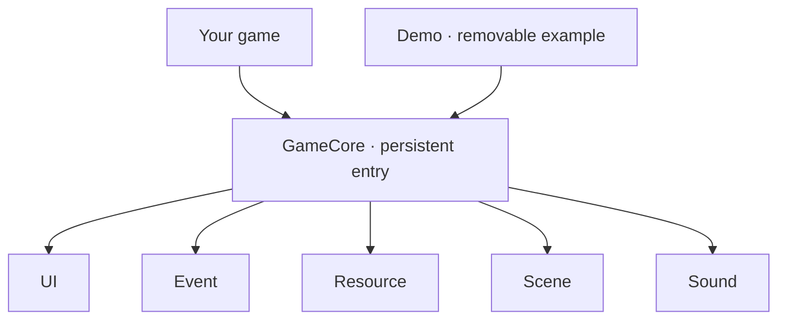

# MinimalUnityGameFramework

English · [简体中文](README.zh-CN.md)

**Version:** [v0.1.0](https://github.com/AngusK97/MinimalUnityGameFramework/releases/tag/v0.1.0) · **Unity:** 6.6 (6000.6.5f1, not LTS)

[Quick start](docs/quick-start.md)

Hello there ~ I'm Angus, a game developer. This is a small Unity framework for UI, events, resources, scenes and audio. Try the Demo, then use the same tools to make your own game.

> **Simple is beautiful.** Keep things small, clear, and easy to change.

## Philosophy

- **Make the flow explicit.** Register your content, then open the first screen.
- **Know who cleans up.** Core owns services; UI owns windows; resource modules own their loaded assets.
- **Use Unity's tools first.** Components, the Inspector and ordinary C# are enough for most tasks.
- **Grow with the game.** Keep its rules and data in its own folder. Extract shared code when you need it.

## The big picture

**GameCore** provides five services and stays alive across scene changes. Your game and the removable Demo use the same API.



**Prepare services → Register content → Open the first screen → Run the game.**

UI loads windows through Resource. Scene coordinates loading, fades and UI cleanup. Startup and lifecycle details are in [Core](docs/core.md).

## Pick the module you need

| I want to… | Guide | Entry |
| --- | --- | --- |
| Set up shared services | [Core](docs/core.md) | `GameCore.IsReady` |
| Open or close a window | [UI](docs/ui.md) | `GameCore.UI` |
| Define windows in the Inspector | [UI tables](docs/ui-tables.md) | `UI.asset` → `GameUI.RegisterAll()` |
| Send a notification | [Events](docs/events.md) | `GameCore.Event` |
| Load and release assets | [Resources](docs/resources.md) | `GameCore.Resource` |
| Define shared assets in the Inspector | [Resource tables](docs/resource-tables.md) | `Main.asset` → `MainResources` |
| Change scenes | [Scenes](docs/scenes.md) | `GameCore.Scene` |
| Play a sound | [Audio](docs/audio.md) | `GameCore.Sound` |

## Where things belong

This is the `main` layout; **v0.1.0** keeps the old layout. See [directory migration](Build-in%20Managers%20Usage.md).

```text
Assets/
├── Framework/
│   ├── Scripts/       Shared framework code
│   ├── Prefabs/       Shared Core prefab
│   └── Scenes/        Services-only InitScene
└── GameContent/
    ├── Demo/          Complete, removable teaching game
    └── MyGame/        Your scenes, content, scripts and Editor/Tables
```

Start reading the Demo at [DemoGame.cs](Assets/GameContent/Demo/Scripts/DemoGame.cs), [UI.asset](Assets/GameContent/Demo/Editor/Tables/UI.asset) or [MenuView.cs](Assets/GameContent/Demo/Scripts/UI/MenuView.cs). Once your own game runs, you can [delete the whole Demo](docs/quick-start.md#remove-the-demo).

## Try it

1. Open the repository root in Unity Hub with the Editor version above. Wait for import and compilation.
2. Open `Assets/GameContent/Demo/Scenes/DemoStart.unity` and press Play.
3. Choose **Start**, then move the blue cube to GOAL with **WASD / arrow keys**.


**Play again** restarts; **Menu** returns; **Settings / Escape** opens volume settings.

**Next: [create your first window](docs/quick-start.md)** · [Build your game](docs/build.md)

## Environment & scope

Addressables **2.11.2** · uGUI **2.6.0** · Built-in rendering · old Input Manager.

Use the release above for a fixed snapshot; `main` evolves and `0.x` APIs may change. Existing games can stay pinned. See [Editor upgrades](docs/upgrading.md), [older API migration](Build-in%20Managers%20Usage.md) and [what has been verified](docs/build.md#verification-scope).

These guides describe the current source; fixed **v0.1.0** predates resource tables and parameterless event overloads.

Saves, full-game pause, platform input and release validation are left to your game's needs.

---

If you get stuck, I'd like to hear where: **anguskungcn@foxmail.com**.
