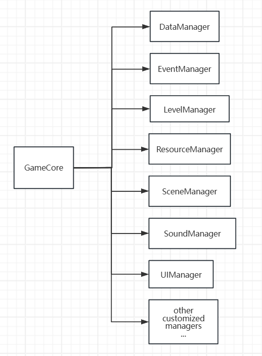
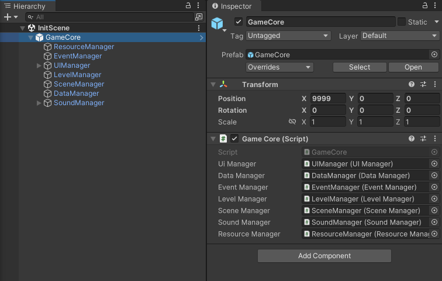

# 01 Framework Structure

`GameCore` owns the persistent services and their lifecycle. The internal plain C# class `MenuStartup` owns menu resource/UI preparation and startup retries, using SceneManager's controlled transition for scene loading and fades. Core creates it after initialization and keeps the existing `StartupError` / `RetryStartup()` entry points. Edit service wiring in Core and menu entry behavior in MenuStartup; no extra component or Prefab setup is required.

`Awake` validates and initializes one persistent Core and its seven explicitly assigned managers. `Start` starts the existing menu flow when **Auto Start Game** is enabled (the default). Disable that option to prepare services while keeping the current scene. Access services after Core assembly, normally from consumer `Start`; wait for resource callbacks before using asynchronous content. UI initialization requires the First layer and transition CanvasGroup.

Keep the Core on a root GameObject and assign managers from its own hierarchy. Duplicate roots are rejected before they can replace the active services. Destroy the whole Core root when ending its lifetime; removing only the component does not dispose its child services. Initialization is separate from starting a new game or resetting progress.

If startup fails, `core.StartupError` contains the diagnostic and the transition mask is hidden immediately. A game-specific error view can read that property and call `core.RetryStartup()`. There is no automatic retry. Accepted startup failures also appear in SceneManager's resource-independent Retry panel; its Retry action delegates to the same startup retry path.

```csharp
// core is a reference to the active GameCore component.
if (core.StartupError != null)
{
    core.RetryStartup(); // true means accepted, not completed successfully
}
```

For ordinary Single scene changes, use `GameCore.Scene.TryTransition(...)`; duplicate requests are rejected while busy. See section 04 of the usage document for entry preparation, completion, ownership and error recovery. Low-level scene wrappers remain available for manual scene management and must not be mixed with the controlled operation.

Only explicit failures can retry; calls while loading, after success, or in services-only mode are rejected. A retry prepares resources without reinitializing services, and reuses the loaded menu scene if it is still valid. It does not cancel an already submitted scene load or restart gameplay.



 `GameCore` is a `MonoBehaviour` script attached to a GameObject. Global classes are also `MonoBehaviour` scripts, attached to the child objects of the GameObject where `GameCore` is located.



# 02 Global Managers
The framework currently includes the following global managers:

- **DataManager**: Handles data access and modification.
- **EventManager**: Registers and broadcasts events.
- **LevelManager**: Manages specific in-level logic.
- **ResourceManager**: Loads and releases resources.
- **SceneManager**: Handles scene transitions.
- **SoundManager**: Plays music and sound effects.
- **UIManager**: Manages opening and closing of UI interfaces.

Click [here](./Build-in%20Managers%20Usage.md) to see the usage of these build-in managers. You can also refer to my open-source demo, [_ForeverUp!_](https://github.com/AngusK97/Game_ForeverUp_NoPaidResourceVersion), for additional insights.

# 03 Add A New Global Manager
1. Ensure the new manager inherits from `MonoBehaviour`.
2. Create a child object under the `GameCore` GameObject and attach the new manager script to it.
3. Add a variable for the new manager in `GameCore`.
4. Drag and drop the manager reference to `GameCore`.

# 04 Updates

The first Stage A fix keeps the existing manager APIs and makes Unity the only per-frame driver for each UI view. Event dispatch uses listener snapshots and a double-buffered deferred queue.

# 05 Discussion
If you have any questions or suggestions, feel free to reach out and discuss with me: **anguskungcn@foxmail.com**.
