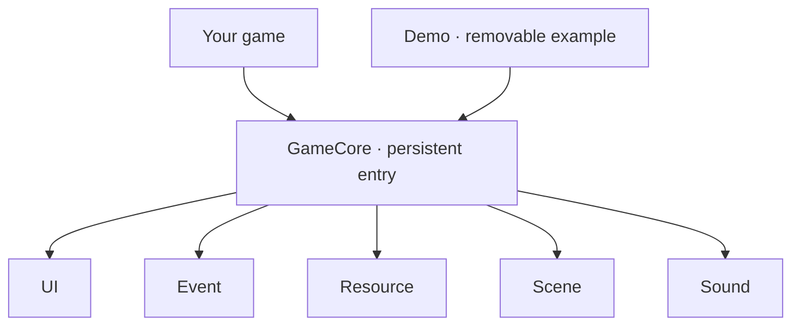

# MinimalUnityGameFramework

English · [简体中文](README.zh-CN.md)

Hello there ~ I'm Angus, a game developer.

This is a small Unity framework I've been working on. I wanted a few familiar tools for starting a game: opening windows, loading resources, changing scenes, sending events and playing sounds.

My hope is that you can try the Demo, see how the pieces fit, and then make something of your own.

> **Simple is beautiful.** Keep things small, clear, and easy to change.

[Start here](docs/quick-start.md) · [Build your game](docs/build.md) · [Upgrade an older project](Build-in%20Managers%20Usage.md)

## Philosophy

- **Keep the flow easy to follow.** Your startup tells the framework which windows and resources exist, then opens the first screen. You can read the calls in order.
- **Know who cleans up.** Core keeps the services alive. UIManager loads and releases windows. A resource module keeps a group of assets until you unload it.
- **Start with Unity's own tools.** Use familiar components and the Inspector. Add a tool when it saves repeated work.
- **Build what your game needs.** Keep its rules and data in your game folder. Share more code when real projects give you a reason to.

## The big picture

Think of **GameCore** as the place to reach the five shared tools. It stays alive when scenes change. Your game and the Demo use the same calls.



Core prepares services in `Awake()`. Your startup uses them in `Start()` after `GameCore.IsReady`:

**Prepare services → Register your content → Open your first screen → Run your game.**

UI uses Resource to load windows. Scene handles scene loading and closes the previous UI at the right point.

Core checks pending UI requests and sends queued events each frame. Unity updates windows and gameplay scripts. Loading and fades use Addressables and DOTween.

## Pick the module you need

Pick the task you want to do. Each guide starts with a short example; extra notes are folded below it.

| Guide | What it handles | Main entry |
| --- | --- | --- |
| [Core](docs/core.md) | Service setup and lifetime | `GameCore.IsReady` |
| [UI](docs/ui.md) | Open, close and release windows | `GameCore.UI` |
| [UI tables](docs/ui-tables.md) | Inspector configuration → constants and registration | `UI.asset` → `GameUI.RegisterAll()` |
| [Events](docs/events.md) | Notify interested listeners | `GameCore.Event` |
| [Resources](docs/resources.md) | Load a group and release its owned assets | `GameCore.Resource` |
| [Scenes](docs/scenes.md) | Load, prepare, fade and retry a transition | `GameCore.Scene` |
| [Audio](docs/audio.md) | Play, pause and stop by layer | `GameCore.Sound` |

For an end-to-end first window, follow [Quick start](docs/quick-start.md). For packaging and common failures, use [Build & troubleshoot](docs/build.md).

## Where things belong

```text
Assets/
├── Scripts/                       Shared framework
├── GameResources/                 Shared Core prefab and InitScene
└── GameContent/
    ├── .gitkeep                   Keeps the content root
    ├── Demo/                      Complete, removable teaching game
    └── MyGame/                    Your game
        ├── Scenes/                Your entry scenes
        ├── Content/               Runtime prefabs, scenes and audio
        ├── Editor/Tables/         Authoring sources, starting with UI.asset
        └── Scripts/               Startup and gameplay
            └── Generated/         Generated UI constants and registration
```

**The framework handles common tasks. You decide how your game works.** Keep its rules, window names, settings, progress and navigation in its own folder. Demo follows the same rule. Its code, content, configuration and build helper all live inside `GameContent/Demo`, so the folder can be [deleted as a whole](docs/quick-start.md#remove-the-demo).

## Try it

1. Open the repository root in Unity Hub and wait for import/compilation.
2. Open `Assets/GameContent/Demo/Scenes/DemoStart.unity` and press Play.
3. Choose **Start**, then use **WASD / arrow keys** to move the blue cube to GOAL.

**Play again** restarts; **Menu** returns; **Settings / Escape** opens volume settings. The shared `InitScene.unity` initializes services only; use DemoStart to see the teaching game.

Then [create your own first window](docs/quick-start.md). The Demo's three reading entry points are [DemoGame.cs](Assets/GameContent/Demo/Scripts/DemoGame.cs), [UI.asset](Assets/GameContent/Demo/Editor/Tables/UI.asset) and [MenuView.cs](Assets/GameContent/Demo/Scripts/UI/MenuView.cs).

## Environment & scope

The project declares **Unity 2022.3.30f1** and **Addressables 1.21.21**. Current validation used **Unity 2022.3.59f1**, including Mac development builds; see [build scope](docs/build.md#verification-scope).

This is a foundation for a game. Saves, full-game pause, platform input and release requirements belong to each project's actual needs.

---

If you try it and get stuck, I'd like to hear where. A confusing step is something we can make clearer together.

Say hello: **anguskungcn@foxmail.com**.
