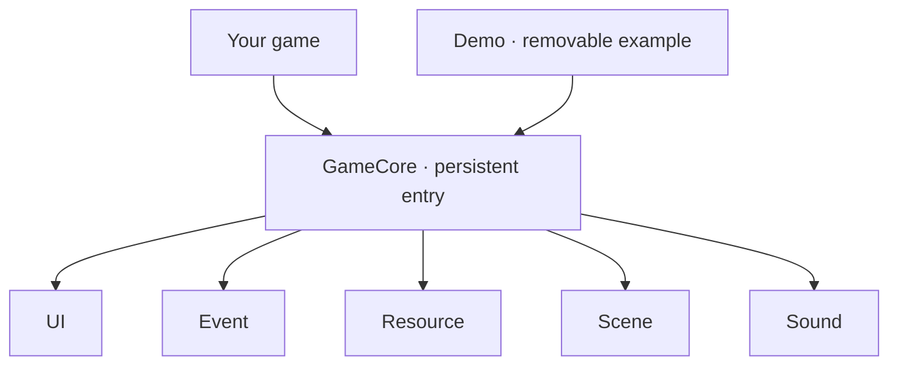

# MinimalUnityGameFramework

English · [简体中文](README.zh-CN.md)

**Version:** v0.4.1 (Config toolbar) · **Unity:** 6.6 (6000.6.5f1, not LTS)

[Download v0.4.1 (ZIP)](https://github.com/AngusK97/MinimalUnityGameFramework/archive/refs/tags/v0.4.1.zip) · [Quick start](docs/quick-start.md)

These guides match **v0.4.1**. See the [release notes](https://github.com/AngusK97/MinimalUnityGameFramework/releases/tag/v0.4.1) and [migration steps](Build-in%20Managers%20Usage.md). Keep downloaded code and guides together.

Hello there ~ I'm Angus, a game developer. This is a small Unity framework for UI, events, resources, scenes and audio. Try the Demo, then use the same tools to make your own game.

> **Simple is beautiful.** Easy to start, easy to understand, easy to change.

<a id="philosophy"></a>

## 01 Philosophy

- **Keep everyday tasks direct.** Make configuration easy to edit and features easy to call.
- **Make flow and ownership clear.** Initialization, loading and cleanup each have an explicit owner.
- **Keep one source for each configuration.** Edit the source; let tools generate code and runtime data.
- **Use the right existing tools.** Inspector for component settings, sheets for bulk configuration, ordinary C# for game logic.
- **Grow from real needs.** Keep gameplay in your game. Extract shared code when the same need comes up again.

<a id="the-big-picture"></a>

## 02 The big picture

**GameCore** provides five services and stays alive across scene changes. Your game and the removable Demo use the same API.

Configuration follows a separate path: **Google Sheets → Update Config in the left toolbar → local data → your game**. The running game reads local data and needs no Google connection.



**Prepare services → Load config and register content → Open the first screen → Run the game.**

UI loads windows through Resource. Scene coordinates loading, fades and UI cleanup. Startup and lifecycle details are in [Core](docs/core.md).

<a id="pick-the-module-you-need"></a>

## 03 Pick the module you need

New here? Start with [your first window](docs/quick-start.md#02-create-your-first-window). For a specific task, pick a guide below. [Google setup](docs/config-setup.md) is a one-time step for editing tables.

| I want to… | Guide | Entry |
| --- | --- | --- |
| Set up shared services | [Core](docs/core.md) | `GameCore.IsReady` |
| Open or close a window | [UI](docs/ui.md) | `GameCore.UI` |
| Edit and read configuration | [Config tables](docs/config.md) | **Update Config** → `GameConfig.LoadAndRegister()` |
| Define windows | [UI tables](docs/ui-tables.md) | `UI` tab → `UIName.Shop` |
| Send a notification | [Events](docs/events.md) | `GameCore.Event` |
| Load and release assets | [Resources](docs/resources.md) | `GameCore.Resource` |
| Define shared assets | [Resource tables](docs/resource-tables.md) | `Resource` tab → `MainResources` |
| Define and change scenes | [Scenes](docs/scenes.md) | `Scene` tab → `SceneName.Menu` |
| Play a sound | [Audio](docs/audio.md) | `GameCore.Sound` |

<a id="where-things-belong"></a>

## 04 Where things belong

Shared code stays in Framework; each game owns its source settings and generated configuration. Existing projects can follow [migration notes](Build-in%20Managers%20Usage.md).

```text
Assets/
├── Framework/
│   ├── Scripts/       Shared framework code
│   ├── Prefabs/       Shared Core prefab
│   └── Scenes/        Services-only InitScene
└── GameContent/
    ├── Demo/          Complete, removable teaching game
    └── MyGame/        Your scenes, content, source settings and generated data
```

Start reading the Demo at [DemoGame.cs](Assets/GameContent/Demo/Scripts/DemoGame.cs), [UI.csv](Assets/GameContent/Demo/Editor/Tables/Generated/UI.csv) or [MenuView.cs](Assets/GameContent/Demo/Scripts/UI/MenuView.cs). CSV files are generated snapshots; edit Google Sheets to change configuration. Once your own game runs, you can [delete the whole Demo](docs/quick-start.md#03-remove-the-demo).

<a id="try-it"></a>

## 05 Try it

The Demo includes local generated data. No Google account or credentials are needed to play.

1. Open the repository root in Unity Hub with the Editor version above. Wait for import and compilation.
2. Open `Assets/GameContent/Demo/Scenes/DemoStart.unity` and press Play.
3. Choose **Start**, then move the blue cube to GOAL with **WASD / arrow keys**.


**Play again** restarts; **Menu** returns; **Settings / Escape** opens volume settings.

**Next: [create your first window](docs/quick-start.md)** · [Build your game](docs/build.md)

<a id="environment--scope"></a>

## 06 Environment & scope

Addressables **2.11.2** · uGUI **2.6.0** · Built-in rendering · old Input Manager.

The download and guides above use **v0.4.1**, with the Google Sheets update button on the left side of Unity's top toolbar. `0.x` APIs may change. Existing games can keep their pinned version and its bundled guides. See [Editor upgrades](docs/upgrading.md), [older API migration](Build-in%20Managers%20Usage.md) and [what has been verified](docs/build.md#04-verification-scope).

Gameplay parameters can stay in the Inspector or game-owned ScriptableObjects. Text/localization and sound-playback tables are deferred; AudioClip resource registration is included. Saves, full-game pause, platform input and release validation are left to your game's needs.

---

If you get stuck, I'd like to hear where: **anguskungcn@foxmail.com**.
