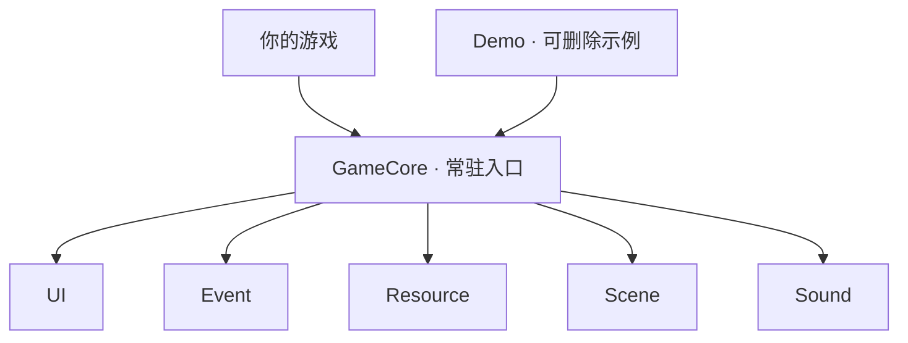

# MinimalUnityGameFramework

[English](README.md) · 简体中文

**框架版本：** main 预览版（Google Sheets 配置） · **Unity：** 6.6（6000.6.5f1，非 LTS）

[下载 main 预览版（ZIP）](https://github.com/AngusK97/MinimalUnityGameFramework/archive/refs/heads/main.zip) · [开始使用](docs/quick-start.zh-CN.md)

本套教程跟随 `main`。需要固定版本时，可用 [v0.2.0](https://github.com/AngusK97/MinimalUnityGameFramework/releases/tag/v0.2.0)；它仍采用原 Inspector/SO 流程，请阅读[对应版本教程](https://github.com/AngusK97/MinimalUnityGameFramework/blob/v0.2.0/docs/quick-start.zh-CN.md)。下载的代码与随包文档一起使用。

Hello there ~ 我是 Angus，一名游戏开发者。这是一个处理 UI、事件、资源、场景和音频的小 Unity 框架。先玩一下 Demo，再用同样的工具做自己的游戏。

> **简单即美。** 小一点，清楚一点，也容易修改一点。

## 设计哲学

- **让流程明确。** 登记自己的内容，再打开首个界面。
- **知道谁来收尾。** Core 管服务，UI 管窗口，资源模块管自己加载的资产。
- **先用 Unity 的工具。** 组件、Inspector 和普通 C# 足以解决大部分问题。
- **按游戏需要增加。** 规则和数据留在游戏目录，需要共用时再提取。

## 宏观架构

**GameCore** 提供五项公共服务，切场景时保持运行。自己的游戏和可删除的 Demo 使用同一套 API。



**准备服务 → 加载配置并登记内容 → 打开首个界面 → 运行游戏。**

UI 通过 Resource 加载窗口；Scene 协调加载、渐变和 UI 收尾。启动与生命周期细节见 [Core](docs/core.zh-CN.md)。

## 按需要选择模块

| 我想…… | 手册 | 入口 |
| --- | --- | --- |
| 准备公共服务 | [Core](docs/core.zh-CN.md) | `GameCore.IsReady` |
| 打开或关闭窗口 | [UI](docs/ui.zh-CN.md) | `GameCore.UI` |
| 连接和更新 Google Sheets | [配置表](docs/config.zh-CN.md) | **Update Config** → `GameConfig.LoadAndRegister()` |
| 定义界面 | [UI 配置表](docs/ui-tables.zh-CN.md) | `UI` 标签 → `UIName.Shop` |
| 发送通知 | [事件](docs/events.zh-CN.md) | `GameCore.Event` |
| 加载与释放资产 | [资源](docs/resources.zh-CN.md) | `GameCore.Resource` |
| 定义共享资产 | [资源配置表](docs/resource-tables.zh-CN.md) | `Resource` 标签 → `MainResources` |
| 定义与切换场景 | [场景](docs/scenes.zh-CN.md) | `Scene` 标签 → `SceneName.Menu` |
| 播放声音 | [音频](docs/audio.zh-CN.md) | `GameCore.Sound` |

## 内容放在哪里

公共代码放在 Framework，每个游戏保存自己的来源设置与生成配置。已有工程可参考[迁移说明](Build-in%20Managers%20Usage.zh-CN.md)。

```text
Assets/
├── Framework/
│   ├── Scripts/       公共框架代码
│   ├── Prefabs/       公共 Core 预制体
│   └── Scenes/        只初始化服务的 InitScene
└── GameContent/
    ├── Demo/          完整、可整体删除的教学游戏
    └── MyGame/        自己的场景、内容、来源设置和生成数据
```

阅读 Demo 可从 [DemoGame.cs](Assets/GameContent/Demo/Scripts/DemoGame.cs)、[UI.csv](Assets/GameContent/Demo/Editor/Tables/Generated/UI.csv) 或 [MenuView.cs](Assets/GameContent/Demo/Scripts/UI/MenuView.cs) 开始。CSV 是生成快照；修改配置时编辑 Google Sheets。自己的游戏跑通后，可以[整体删除 Demo](docs/quick-start.zh-CN.md#删除-demo)。

## 先体验一次

Demo 已附带本地生成数据，不需要 Google 账号或凭据即可运行。

1. 在 Unity Hub 用上面的 Editor 版本打开仓库根目录，等待导入和编译完成。
2. 打开 `Assets/GameContent/Demo/Scenes/DemoStart.unity`，点击 Play。
3. 点击 **Start**，用 **WASD / 方向键**把蓝色方块移到 GOAL。


**Play again** 重开，**Menu** 返回，**Settings / Escape** 打开音量设置。

**下一步：[创建自己的第一个窗口](docs/quick-start.zh-CN.md)** · [构建游戏](docs/build.zh-CN.md)

## 环境与范围

Addressables **2.11.2** · uGUI **2.6.0** · Built-in 渲染管线 · 旧 Input Manager。

上面的下载与教程跟随 **main 预览版**，其中 Google Sheets 流程不属于 v0.2.0。`0.x` 的 API 仍可能变化。旧游戏可以继续固定原版本，使用随包文档。按需查看 [Editor 升级](docs/upgrading.zh-CN.md)、[旧 API 迁移](Build-in%20Managers%20Usage.zh-CN.md)和[已验证范围](docs/build.zh-CN.md#验证范围)。

玩法参数可以继续放在 Inspector 或游戏自己的 ScriptableObject。文本／本地化与声音播放配置表暂缓，当前包含 AudioClip 资源登记。存档、全局暂停、平台输入和发布验收，按自己的游戏需要补充。

---

如果你试用时卡住了，欢迎告诉我卡在哪一步：**anguskungcn@foxmail.com**。
