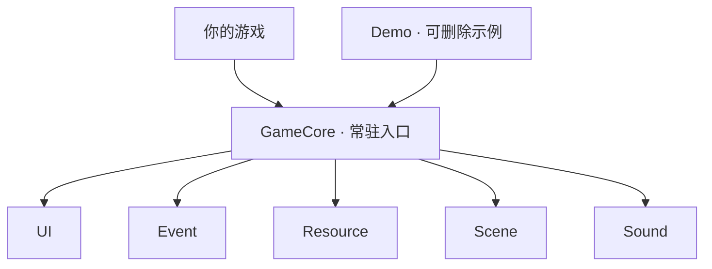
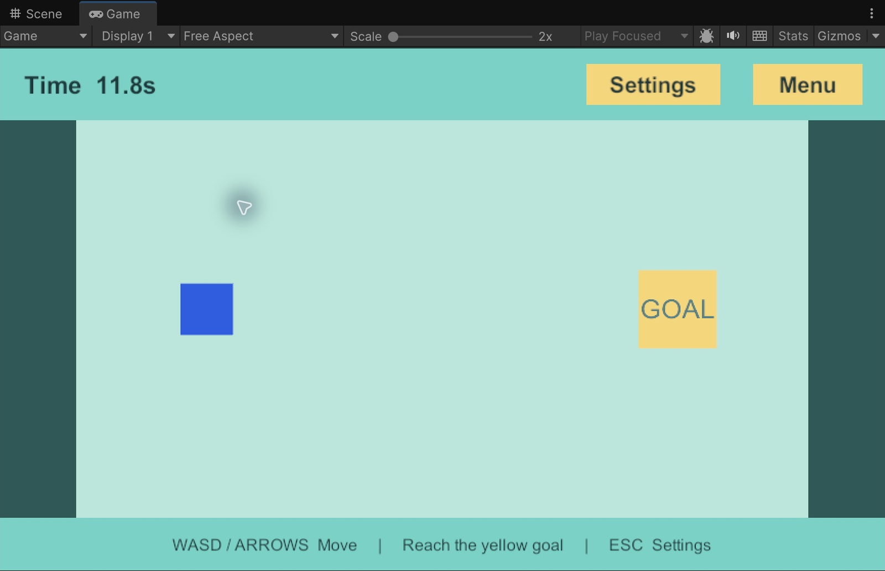

# MinimalUnityGameFramework

[English](README.md) · 简体中文

**框架版本：** v0.4.0（配置工具栏） · **Unity：** 6.6（6000.6.5f1，非 LTS）

[下载 v0.4.0（ZIP）](https://github.com/AngusK97/MinimalUnityGameFramework/archive/refs/tags/v0.4.0.zip) · [开始使用](docs/quick-start.zh-CN.md)

这套教程适用于 **v0.4.0**。更新了什么，可以看[发布说明](https://github.com/AngusK97/MinimalUnityGameFramework/releases/tag/v0.4.0)；旧工程升级请看[迁移步骤](Build-in%20Managers%20Usage.zh-CN.md)。下载后，使用包内的文档即可。

Hello there ~ 我是 Angus，一名游戏开发者。这是我写的一个小型 Unity 框架，帮你处理 UI、事件、资源、场景和音频。可以先玩一下 Demo，再用同样的工具做自己的游戏。

> **简单即美。** 容易上手，容易理解，也容易修改。

<a id="设计哲学"></a>

## 01 设计哲学

- **让常用操作直接。** 配置方便编辑，功能方便调用。
- **让流程和归属清楚。** 何时初始化、加载和释放，每件事都有明确的负责者。
- **同一份配置，只维护一个来源。** 修改源数据，让工具生成代码和运行数据。
- **使用合适的现成工具。** 组件参数用 Inspector，批量配置用表格，游戏逻辑用普通 C#。
- **按真实需要扩展。** 玩法留在自己的游戏里，出现重复需求时再提取公共能力。

<a id="宏观架构"></a>

## 02 宏观架构

**GameCore** 提供五个公共模块，切换场景时也会保留。你自己的游戏和 Demo 都通过同一套 API 使用它们。

配置从表格进入游戏：**Google Sheets → 点击 Play 左侧的 Update Config → 生成本地数据 → 游戏读取**。运行游戏时不需要连接 Google。



**准备公共服务 → 加载配置、登记内容 → 打开第一个界面 → 开始游戏。**

UI 通过 Resource 加载界面；Scene 负责场景加载、淡入淡出和旧界面的清理。初始化和退出时需要做什么，见 [Core](docs/core.zh-CN.md)。

<a id="按需要选择模块"></a>

## 03 按需要选择模块

第一次使用，可以跟着教程做[自己的第一个窗口](docs/quick-start.zh-CN.md#02-创建第一个窗口)。有具体需求时，直接查下面的表。需要编辑配置表时，再完成一次 [Google 连接设置](docs/config-setup.zh-CN.md)。

| 我想…… | 教程 | 从哪里调用 |
| --- | --- | --- |
| 准备公共服务 | [Core](docs/core.zh-CN.md) | `GameCore.IsReady` |
| 打开或关闭窗口 | [UI](docs/ui.zh-CN.md) | `GameCore.UI` |
| 编辑和读取配置 | [配置表](docs/config.zh-CN.md) | **Update Config** → `GameConfig.LoadAndRegister()` |
| 登记 UI 界面 | [UI 配置表](docs/ui-tables.zh-CN.md) | `UI` 工作表 → `UIName.Shop` |
| 发送通知 | [事件](docs/events.zh-CN.md) | `GameCore.Event` |
| 加载与释放资源 | [资源](docs/resources.zh-CN.md) | `GameCore.Resource` |
| 登记资源 | [资源配置表](docs/resource-tables.zh-CN.md) | `Resource` 工作表 → `MainResources` |
| 登记与切换场景 | [场景](docs/scenes.zh-CN.md) | `Scene` 工作表 → `SceneName.Menu` |
| 播放声音 | [音频](docs/audio.zh-CN.md) | `GameCore.Sound` |

<a id="内容放在哪里"></a>

## 04 内容放在哪里

公共代码放在 Framework。自己的场景、脚本、配置来源设置和生成数据，都放在各自的游戏目录里。旧工程调整目录时，可参考[迁移说明](Build-in%20Managers%20Usage.zh-CN.md)。

```text
Assets/
├── Framework/
│   ├── Scripts/       公共框架代码
│   ├── Prefabs/       公共 Core 预制体
│   └── Scenes/        只初始化服务的 InitScene
└── GameContent/
    ├── Demo/          完整、可整体删除的教学游戏
    └── MyGame/        自己的场景、内容、来源设置和生成数据
```

想看 Demo 怎么写，可以从 [DemoGame.cs](Assets/GameContent/Demo/Scripts/DemoGame.cs)、[UI.csv](Assets/GameContent/Demo/Editor/Tables/Generated/UI.csv) 或 [MenuView.cs](Assets/GameContent/Demo/Scripts/UI/MenuView.cs) 开始。CSV 保存的是导表结果；需要改配置时，去 Google Sheets 修改。自己的游戏跑通后，可以[整体删除 Demo](docs/quick-start.zh-CN.md#03-删除-demo)。

<a id="先体验一次"></a>

## 05 先体验一次

Demo 自带运行所需的配置，不用设置 Google 账号或密钥。

1. 在 Unity Hub 中，用上面的 Unity 版本打开工程根目录，等待导入和编译完成。
2. 打开 `Assets/GameContent/Demo/Scenes/DemoStart.unity`，点击 Play。
3. 点击 **Start**，用 **WASD / 方向键**把蓝色方块移到 GOAL。



**Play again** 重开，**Menu** 返回，**Settings / Escape** 打开音量设置。

**下一步：[创建自己的第一个窗口](docs/quick-start.zh-CN.md)** · [构建游戏](docs/build.zh-CN.md)

<a id="环境与范围"></a>

## 06 环境与范围

Addressables **2.11.2** · uGUI **2.6.0** · Built-in 渲染管线 · 旧 Input Manager。

上面的下载链接和教程适用于 **v0.4.0**，可在工具栏直接更新 Google Sheets 配置。`0.x` 阶段的 API 仍可能调整，已有游戏可以继续使用原来的版本和文档。需要升级时，再查看 [Unity 升级](docs/upgrading.zh-CN.md)、[旧 API 迁移](Build-in%20Managers%20Usage.zh-CN.md)和[已验证范围](docs/build.zh-CN.md#04-验证范围)。

玩法参数可以继续放在 Inspector 或游戏自己的 ScriptableObject 中。文本／本地化和声音播放参数暂时没有专用表，AudioClip 资源已经可以在资源表中登记。存档、全局暂停、不同平台的输入，以及正式发布前的验证，按自己游戏的需要补充。

---

如果你试用时卡住了，欢迎告诉我卡在哪一步：**anguskungcn@foxmail.com**。
