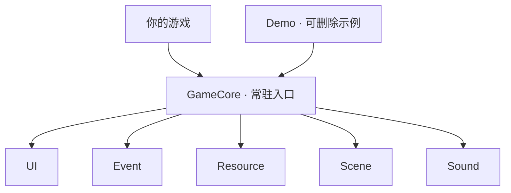

# MinimalUnityGameFramework

[English](README.md) · 简体中文

**框架版本：** [v0.1.0](https://github.com/AngusK97/MinimalUnityGameFramework/releases/tag/v0.1.0) · **Unity：** 6.6（6000.6.5f1）

Hello there ~ 我是 Angus，一名游戏开发者。

这是我一直在完善的一个小 Unity 框架。我想把开始做游戏时常用的几件事放在一起：打开界面、加载资源、切换场景、发送事件，还有播放声音。

希望你能先玩一下 Demo，看看这些部分怎么配合，再用它做一点属于自己的东西。

> **简单即美。** 小一点，清楚一点，也容易修改一点。

[开始使用](docs/quick-start.zh-CN.md) · [构建游戏](docs/build.zh-CN.md) · [升级到 Unity 6.6](docs/upgrading.zh-CN.md) · [旧 API 迁移](Build-in%20Managers%20Usage.zh-CN.md)

## 设计哲学

- **让流程读得懂。** 自己的启动脚本告诉框架有哪些界面和资源，再打开第一个界面。顺着调用就能知道接下来做什么。
- **知道谁来收尾。** Core 保持服务运行，UIManager 加载和释放窗口，资源模块保存一组素材，直到你让它卸载。
- **先用 Unity 自带的工具。** 从熟悉的组件和 Inspector 开始，重复劳动多了，再加工具帮忙。
- **按游戏需要慢慢增加。** 规则和数据放在自己的游戏目录里，真实项目需要共用代码时，再把它提取出来。

## 宏观架构

可以把 **GameCore** 理解成找到这五项公共工具的地方。切场景时它会保留下来，自己的游戏和 Demo 都通过同样的调用来使用它们。



Core 在 `Awake()` 准备服务；自己的入口在 `Start()` 中检查 `GameCore.IsReady` 后使用：

**准备服务 → 登记自己的内容 → 打开首个界面 → 运行游戏。**

UI 通过 Resource 加载窗口；Scene 负责加载场景，并在合适的时候关闭之前的 UI。

Core 每帧检查待处理的 UI 请求、发送排队中的事件，窗口和玩法脚本由 Unity 更新。加载和渐变分别使用 Addressables 与 DOTween。

## 按需要选择模块

想做哪件事，就打开对应的手册。每篇先放一个短例子，详细说明折叠在后面。

| 手册 | 负责什么 | 常用入口 |
| --- | --- | --- |
| [Core](docs/core.zh-CN.md) | 公共服务的装配与生命周期 | `GameCore.IsReady` |
| [UI](docs/ui.zh-CN.md) | 打开、关闭与释放窗口 | `GameCore.UI` |
| [UI 配置表](docs/ui-tables.zh-CN.md) | Inspector 配置 → 常量和登记代码 | `UI.asset` → `GameUI.RegisterAll()` |
| [事件](docs/events.zh-CN.md) | 向监听者发送通知 | `GameCore.Event` |
| [资源](docs/resources.zh-CN.md) | 按组加载，按归属释放 | `GameCore.Resource` |
| [场景](docs/scenes.zh-CN.md) | 加载、准备、渐变与失败重试 | `GameCore.Scene` |
| [音频](docs/audio.zh-CN.md) | 按层播放、暂停和停止 | `GameCore.Sound` |

从零完成第一个窗口，阅读[开始使用](docs/quick-start.zh-CN.md)；打包或排查常见问题，阅读[构建与排错](docs/build.zh-CN.md)。

## 内容放在哪里

```text
Assets/
├── Scripts/                       公共框架
├── GameResources/                 公共 Core 预制体和 InitScene
└── GameContent/
    ├── .gitkeep                   保留稳定的内容根目录
    ├── Demo/                      完整、可整体删除的教学游戏
    └── MyGame/                    自己的游戏
        ├── Scenes/                自己的入口场景
        ├── Content/               运行时 Prefab、场景与音频
        ├── Editor/Tables/         配置编辑源，从 UI.asset 开始
        └── Scripts/               启动与玩法
            └── Generated/         自动生成的 UI 常量和登记代码
```

**框架处理常见工作，游戏怎么玩由你决定。** 规则、窗口名称、设置、进度和导航都放在自己的游戏目录。Demo 也遵循同样的方式：代码、资产、配置和构建入口都在 `GameContent/Demo` 中，可以[整体删除](docs/quick-start.zh-CN.md#删除-demo)。

## 先体验一次

1. 在 Unity Hub 用 **Unity 6.6（6000.6.5f1）** 打开仓库根目录，等待导入和编译完成。
2. 打开 `Assets/GameContent/Demo/Scenes/DemoStart.unity` 并点击 Play。
3. 点击 **Start**，用 **WASD / 方向键**把蓝色方块移到 GOAL。

**Play again** 重开，**Menu** 返回，**Settings / Escape** 打开音量设置。公共 `InitScene.unity` 只初始化服务；体验教学游戏请使用 DemoStart。

之后[创建自己的第一个窗口](docs/quick-start.zh-CN.md)。阅读 Demo 可从 [DemoGame.cs](Assets/GameContent/Demo/Scripts/DemoGame.cs)、[UI.asset](Assets/GameContent/Demo/Editor/Tables/UI.asset) 和 [MenuView.cs](Assets/GameContent/Demo/Scripts/UI/MenuView.cs) 三处开始。

## 环境与范围

需要固定起点时，使用 [v0.1.0 发布版](https://github.com/AngusK97/MinimalUnityGameFramework/releases/tag/v0.1.0)。`main` 会继续更新，`0.x` 开发阶段的公共 API 仍可能变化。

当前基线为 **Unity 6.6（6000.6.5f1）**、**Addressables 2.11.2**、**uGUI 2.6.0**。Unity 6.6 不是 LTS 版本。继续使用 Built-in 渲染管线与旧 Input Manager。导入、C# 编译与 13 项针对性迁移检查已通过，包括删除 Demo 和两份 macOS Mono 开发构建。完整原生输入与音频验收仍需单独完成；实际范围见[构建手册](docs/build.zh-CN.md#验证范围)。

已经使用旧版的项目可以继续固定旧版。决定迁移时，再按[升级说明](docs/upgrading.zh-CN.md)在独立副本中操作。

这里提供游戏开发的基础。存档、全局暂停、平台输入与发布保障，按具体项目的实际需求补充。

---

如果你试用时卡住了，也欢迎告诉我卡在哪一步。我们可以把那一小段再写清楚一点。

来打个招呼吧：**anguskungcn@foxmail.com**。
