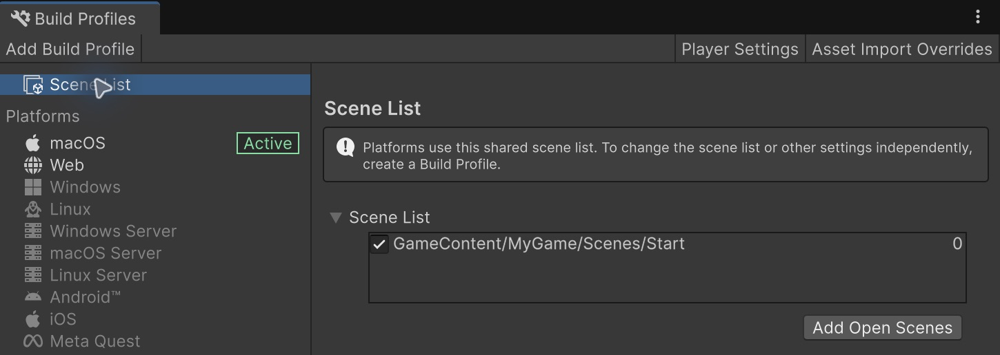

# Build & troubleshoot

[Overview](../README.md) · [Quick start](quick-start.md) · [简体中文](build.zh-CN.md)

**Once your game runs in the Editor, let's make an app you can open on its own.** Unity calls that app a Player: choose the entry scene, build its assets, then build the Player.

## Build the Demo

1. Open **File → Build Profiles**. Under **Platforms**, select an installed target; click **Switch Platform** if it is not already Active. For a first Mac build, choose macOS.
2. Exit Play, generate any changed UI tables and wait for compilation.
3. Choose **Demo → Build Player**, then select an output location.
4. Open the built app. You should see the Demo menu, just as in the Editor. Try Start → keyboard win → Play again → Menu → Settings → Quit.

The Demo helper builds Addressables and supplies DemoStart for that build. It preserves the saved scene list and disappears when Demo is deleted.

## Build your game

1. Open **File → Build Profiles**. Select your target under **Platforms** and click **Switch Platform** if needed; the active platform is marked Active.
2. Select **Scene List** on the left. Drag your `MyGame/Scenes/Start.unity` from Project into the list, put it first and enable its checkbox. Remove the services-only InitScene if unneeded; keep other native scenes your game uses. **Open Scene List** in a platform panel opens the same shared list.
3. Generate changed UI tables and wait for compilation.
4. Open **Window → Asset Management → Addressables → Groups**. Choose **Build → New Build → Default Build Script** and wait for success.
5. Return to your target under **Platforms**, choose **Build** and an output location.
6. Open the built app. Your own first screen should appear. Try its UI, input, sound and transitions.

*Step 2 example — Build Profiles → Scene List: MyGame/Scenes/Start is enabled as the first scene.*

Rebuild content after changing resources or target platform. **Use Asset Database (fastest)** is an Editor play-mode option; it does not supply a Player content build.

Optional: custom build profiles

Add a custom build profile later if you need independent settings or scene lists. Your first build does not need one.

## If something fails

| Symptom | First check |
| --- | --- |
| No Demo menu | Open DemoStart.unity. InitScene deliberately initializes services only. |
| GameUI is missing | Temporarily remove/comment callers of the missing generated class, fix compilation, generate the table, then restore callers. |
| Generator is absent/disabled | Resolve Console compile errors, select UI.asset, exit Play and wait for compilation. |
| Invalid prefab | Reference a saved prefab with one UIBase-derived component on its root. |
| No loadable address | Keep runtime content under GameContent; check group Include in Build and Include Addresses in Catalog. |
| Window fails to open | Check Core readiness, RegisterAll, the actual address and the first Console error. |
| Duplicate EventSystem/AudioListener | Keep the shared Core's infrastructure; remove extra copies from scenes/prefabs. |
| Stale/edited output blocks build | Fix the table or restore generated output, generate and wait for compilation. |
| Player shows only a background | Put your own entry first; the default saved list contains only InitScene. |
| Scene load fails | Check its real Addressables key and rebuild content for the selected target. |

## Verification scope

Baseline: Unity **6.6 (6000.6.5f1)**, Addressables **2.11.2**, uGUI **2.6.0**. Import and C# compilation passed; the default assemblies compiled again after removing temporary validation scripts. **13 focused checks passed** in disposable migration projects:

- UI-table generation and repeat generation without rewriting output; Demo services, transitions, settings pause, win, restart and return. The win check used a temporary probe to place the player at GOAL; it did not verify keyboard movement.
- A fresh project with no Library cache, deleting only Demo, then using an independent game with the remaining framework.
- Demo and independent-game **macOS Mono development** content/Player builds: both completed with **0 errors and 0 warnings**.

GUI checks confirmed the Demo menu rendered, Escape opened/closed Settings, and the independent Player displayed its own window after Demo removal. The full native mouse flow, real keyboard completion, audible output, other platforms and IL2CPP/release builds have **not** been accepted. These results apply to the baseline above, not every target or release configuration.

For version migration rather than an API lookup, see [Upgrading](upgrading.md). Unity references: [Build Profiles](https://docs.unity3d.com/6000.6/Documentation/Manual/build-profiles.html) and [Scene List](https://docs.unity3d.com/6000.6/Documentation/Manual/build-profile-scene-list.html).

Next: [UI table recovery](ui-tables.md) or [scene transitions](scenes.md).
