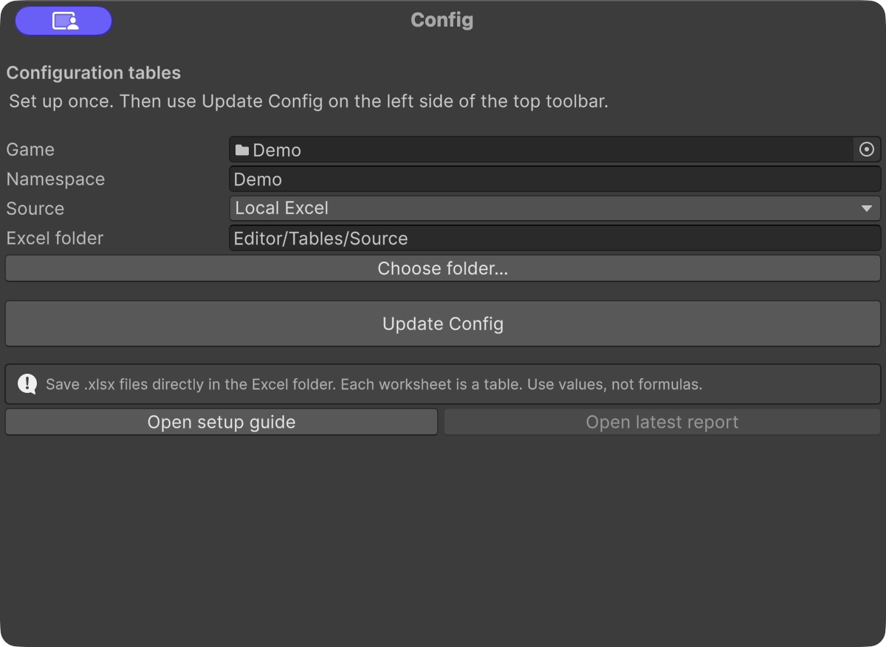

# Config setup

[Overview](../README.md) · [Config tables](config.md) · [Quick start](quick-start.md) · [简体中文](config-setup.zh-CN.md)

**Choose a source once, then use Update Config for later edits.** Local Excel is the default. Google Sheets is available for online collaboration; each game uses one active source.

## 01 First-time setup

### 1.1 Prepare a local workbook

1. Create `Assets/GameContent/MyGame/Editor/Tables/Source/` in your Unity project.
2. In a spreadsheet editor, create a blank workbook. Rename its first sheet **UI** for the [first-window example](quick-start.md#23-connect-and-update-the-ui-table), or **Item** for the [ordinary-data example](config.md#03-add-a-table).
3. Enter the example from A1: field names in row 1, field types in row 2, data from row 3. Remove unused blank sheets and enter values without formulas.
4. Save as `MyGame.xlsx` directly inside the Source folder. The workbook name is up to you; sheet names become table names and must be unique across the folder. The importer reads `.xlsx` files directly in this folder, ignores Excel's `~$` temporary files, and does not scan subfolders.

The bundled `Assets/GameContent/Demo/Editor/Tables/Source/Demo.xlsx` is a working example. To start your own game from it, copy only the sheets you need and replace Demo IDs and asset paths with your own. Keep your source under your game's Editor folder so it is not included as a runtime asset.

### 1.2 Connect Unity

1. Open **Framework → Config**. Set **Game = MyGame**, **Namespace = MyGame**, and **Source = Local Excel**.
2. Keep **Excel folder = Editor/Tables/Source**, or click **Choose folder…** to select another folder inside this game's Editor directory. The path is relative to the game root; the generated-output folder cannot be used as a source.
3. Click **Update Config**. Wait for the progress window, result and any compilation. Use **Open report** for details, then return to your table's tutorial to check its generated output.

The screenshot uses Demo; select **MyGame** for these steps. Settings are saved in `MyGame/Editor/ConfigSource.json`. The local folder is stored relative to the game root, such as `Editor/Tables/Source`. Commit the workbook, settings, generated outputs and Unity meta files together.

For later edits, save the workbook and click **Update Config** on the left side of Unity's top toolbar. It uses the last selected game on this computer and opens Config if setup is incomplete. Use **Framework → Config** to change games or settings.

## 02 Google Sheets (optional)

Use this source when your team wants to edit tables together online. You need a Google account and permission to create a Cloud project and a service account key. Unity uses that service account to read the shared folder.

### 2.1 Prepare Google access

1. **Create a Cloud project.** Open [Google Cloud Console](https://console.cloud.google.com/projectcreate), name it something like `MyGame Config` and create it. Select that project before continuing. [Google's project guide](https://developers.google.com/workspace/guides/create-project).

2. **Enable two APIs.** In **APIs & Services → Library**, find and enable **Google Drive API** and **Google Sheets API** for this project. [Google's API guide](https://developers.google.com/workspace/guides/enable-apis).

3. **Create a service account.** Open **IAM & Admin → Service Accounts → Create service account**. Use a name such as `mygame-config-reader`, then finish with **Done**. Leave the optional project roles and user access fields empty; access to the folder is granted separately in step 5. [Google's service account guide](https://docs.cloud.google.com/iam/docs/service-accounts-create).

4. **Download its JSON key.** Open the new account, then **Keys → Add key → Create new key → JSON → Create**. Move the downloaded file to a private location **outside the Unity project and any Git repository**, such as a private credentials folder. Keep the file on your computer; do not paste its contents into code, Sheets or chat. [Google's key guide](https://docs.cloud.google.com/iam/docs/keys-create-delete).

5. **Create and share a Drive folder.** In [Google Drive](https://drive.google.com/), create `MyGame Config`. Share it with the service account's email shown in Cloud Console—the same value as `client_email` in the key file—as **Viewer**. Uncheck **Notify people** and share. Keep general access restricted; invite designers as **Editor** if needed. This direct sharing needs no domain-wide delegation. [Google's sharing guide](https://developers.google.com/workspace/guides/create-credentials#access-google-workspace-files-directly-with-a-service-account).

### 2.2 Create and connect a table

1. Inside the shared Drive folder, choose **New → Google Sheets → Blank spreadsheet**. Rename the first tab for your table and enter the same headers, types and data used in the local Excel examples. Put native Google Sheets workbooks directly in the folder, without subfolders or shortcuts. An uploaded `.xlsx` must be converted to Google Sheets for this source.
2. Create `Assets/GameContent/MyGame/` if needed. Open **Framework → Config**, select that game folder and set **Namespace = MyGame**, then choose **Source = Google Sheets**. Paste the folder ID into **Google Drive Folder ID**. From `https://drive.google.com/drive/folders/FOLDER_ID`, copy only `FOLDER_ID`. Select your downloaded key in **Service Account JSON**.
3. For a new game, click **Update Config**. If this game already has an applied source, follow section 03 to switch. Wait for the result and any compilation, then return to your table's tutorial.

The source settings are stored in the game's ConfigSource.json. The key's file path stays in this computer's Unity Editor preferences; the key is not copied into the project. Select a locally stored key again on another computer.

Google setup problems

- **Key creation is disabled:** a school or organization policy may block keys. Ask its administrator whether the project can use one. Local Excel needs no key. [Google's key policy guidance](https://docs.cloud.google.com/iam/docs/keys-create-delete#allow-service-account-key-creation).
- **Folder not found / access denied:** check the folder ID, both enabled APIs, and sharing with the exact service account email. Access in your own browser does not grant Unity access.
- **No tables:** use native Google Sheets files directly inside the selected folder. Convert uploaded `.xlsx` files first.

The importer requests read-only Drive metadata and Sheets access; it does not edit cloud tables. Folder sharing is inherited by its files, subject to school or workplace policies. [Google's folder sharing guide](https://support.google.com/drive/answer/7166529?hl=en).

## 03 Switch an existing source

These steps use **Demo**. For your own game, use its folder and namespace instead. Demo already uses local Excel; Google setup is only needed when you choose Google Sheets.

Stop Play mode first. Include every currently applied table in the destination, with the **same table names, field names, field types and column order**. Save table additions, removals and header changes for after the switch. Keep one copy of each table and use literal values, not formulas. Your game code stays the same.

### 3.1 Google Sheets → local Excel

1. **Download the workbooks.** Open each active Google workbook and choose **File → Download → Microsoft Excel (.xlsx)**. Download every workbook and keep all configuration tabs. [Google's download guide](https://support.google.com/docs/answer/9330963?hl=en).
2. **Put them in Source.** Place the files directly in `Assets/GameContent/Demo/Editor/Tables/Source/`; create the folder if needed. Move any existing Demo.xlsx or old workbooks outside Source as a backup before adding the downloaded versions. Do not leave duplicate table names across old and new files or put files in subfolders.
3. **Choose local Excel.** Open **Framework → Config**, select **Game = Demo**, keep **Namespace = Demo**, and set **Source = Local Excel**, **Excel folder = Editor/Tables/Source**.
4. **Click Switch Source.** Wait for the result and any compilation. After success, reopen Config and confirm Source is Local Excel.

From now on: **edit local Excel → save → Update Config**. No Google key or manual CSV export is needed.

### 3.2 Local Excel → Google Sheets

1. **Prepare Google access.** For your first connection, complete [2.1 Prepare Google access](#21-prepare-google-access) to get a shared folder and service account JSON. Reuse an existing working connection if you have one.
2. **Upload and convert the workbooks.** Save your local files. In the shared Drive folder, choose **New → File upload** and upload every `.xlsx` from Source. Open each with Google Sheets, then choose **File → Save as Google Sheets**. If uploads are already converted automatically, skip the second conversion. [Google's conversion guide](https://support.google.com/docs/answer/9331167?hl=en).
3. **Check the destination folder.** Keep the converted native Google Sheets files directly in the shared folder, with the same tab names and first two rows. Move any old workbooks containing the same table names outside that folder as a backup. The tool reads native Google Sheets files only; uploaded `.xlsx` files do not count as source tables.
4. **Choose Google Sheets.** Open **Framework → Config**, select **Game = Demo**, keep **Namespace = Demo**, and set **Source = Google Sheets**. Enter the ID at the end of the shared folder URL in **Google Drive Folder ID**. In **Service Account JSON**, select your local key file stored outside the project.
5. **Click Switch Source.** Wait for the result and any compilation. After success, reopen Config and confirm Source is Google Sheets.

From now on: **edit Google Sheets → wait for cloud saving to finish → Update Config**. You do not need to upload Excel files again for later edits.

### 3.3 Check the result

- **Success:** the result says `Config is up to date`, and Config retains the new source. The toolbar's Update Config now reads only that source. Run the same Demo and check that its menu and level still work.
- **Failure:** the previous source and generated output stay unchanged. Click **Open report**, add missing tables, move duplicate workbooks out, or fix field and asset errors as directed, then retry in Config. All tables must pass together; a source switch cannot apply only some tables.

Switching does not delete the original files. **Local and Google sources do not sync automatically or act as fallbacks.** After success, edit only the active source; daily updates still retain the previous version of invalid tables. Make schema changes or add and remove tables after the switch succeeds.
