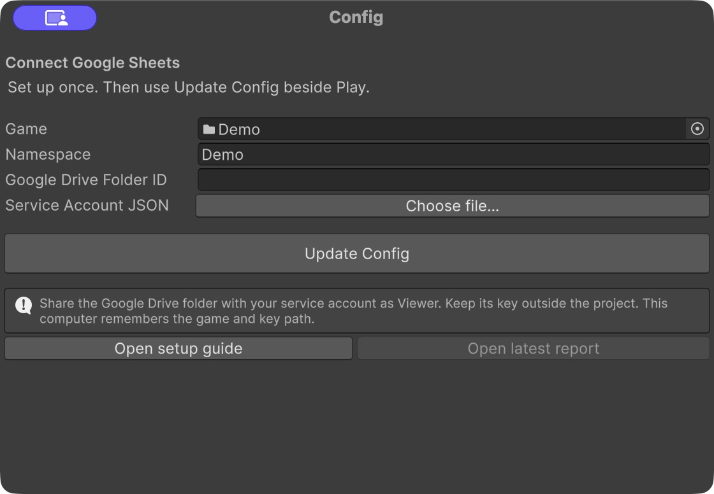

# 配置接入

[总览](../README.zh-CN.md) · [配置表](config.zh-CN.md) · [快速开始](quick-start.zh-CN.md) · [English](config-setup.md)

**先把 Google Sheets 连接到 Unity，之后修改表格只需点击 Update Config。** 随包 Demo 不用设置就能运行；需要编辑表格时，再连接自己的配置来源。

## 01 首次设置

你需要一个 Google 账号，并有权限创建 Cloud 项目和服务账号密钥。Unity 会通过这个服务账号读取共享文件夹。

### 1.1 准备 Google 访问权限

1. **创建 Cloud 项目。** 打开 [Google Cloud Console](https://console.cloud.google.com/projectcreate)，输入项目名称，例如 `MyGame Config`，然后创建。创建后先选中这个项目，再继续下面的步骤。[Google 项目指南](https://developers.google.com/workspace/guides/create-project)。

2. **启用两个 API。** 在 **APIs & Services → Library** 中分别搜索并启用 **Google Drive API** 和 **Google Sheets API**，确认它们属于刚才的项目。[Google API 指南](https://developers.google.com/workspace/guides/enable-apis)。

3. **创建服务账号。** 打开 **IAM & Admin → Service Accounts → Create service account**，输入名称，例如 `mygame-config-reader`，然后点击 **Done**。项目角色和用户访问权限都是可选项，留空即可；第 5 步再单独设置文件夹权限。[Google 服务账号指南](https://docs.cloud.google.com/iam/docs/service-accounts-create)。

4. **下载 JSON 密钥。** 打开新账号，依次选择 **Keys → Add key → Create new key → JSON → Create**。把下载的文件移到 **Unity 工程和任何 Git 仓库之外**的私人目录，例如专门存放凭据的文件夹。密钥留在自己的电脑上，不要把内容粘贴到代码、Sheets 或聊天中。[Google 密钥指南](https://docs.cloud.google.com/iam/docs/keys-create-delete)。

5. **创建并共享 Drive 文件夹。** 在 [Google Drive](https://drive.google.com/) 新建 `MyGame Config` 文件夹。把文件夹共享给 Cloud Console 中显示的服务账号邮箱，也就是密钥文件中的 `client_email`，权限设为 **Viewer（查看者）**。取消勾选 **Notify people（通知人员）**，完成共享。常规访问保持受限。需要编辑表格的策划或组员，可以另外添加为 **Editor（编辑者）**。直接共享文件夹不需要设置全域委派。[Google 共享指南](https://developers.google.com/workspace/guides/create-credentials#access-google-workspace-files-directly-with-a-service-account)。

### 1.2 创建并连接表格

6. **创建第一张表。** 在共享 Drive 文件夹内选择 **New → Google Sheets → Blank spreadsheet**。使用你正在跟着做的教程中的表，例如[快速开始中的 UI 示例](quick-start.zh-CN.md#23-连接并更新-ui-配置表)、普通数据的 [Item 示例](config.zh-CN.md#03-添加一张表)，或资源／场景教程中的 Resource／Scene 表。把第一个工作表标签改成对应的表名，从 A1 开始填入示例内容。工作簿叫什么都可以，框架会把标签名作为表名。工作簿要直接放在这个文件夹中，不要放进子文件夹，也不要使用快捷方式。

7. **连接 Unity。** 如果 `Assets/GameContent/MyGame/` 还不存在，先创建这个文件夹。打开 **Framework → Config**，所有设置项都会直接显示，不需要展开。在 **Game** 选择此文件夹，填写 **Namespace = MyGame**，把文件夹 ID 填入 **Google Drive Folder ID**。例如网址为 `https://drive.google.com/drive/folders/FOLDER_ID` 时，只复制 `FOLDER_ID`。在 **Service Account JSON** 选择下载的密钥文件。

8. **点击 Update Config。** 更新时会显示原生进度窗口，完成后弹出结果。如果 Unity 开始编译，等编译结束再继续；需要详细说明时，点击 **Open report**。确认表格更新成功后，回到刚才的教程检查生成文件，再继续后面的步骤。只创建当前教程用到的表就可以。

文件夹 ID 和命名空间保存在 `Assets/GameContent/MyGame/Editor/ConfigSource.json`。最后选择的游戏和密钥文件路径只保存在这台电脑的 Unity Editor 偏好设置中，密钥不会复制进工程。换电脑后重新选择本机保存的密钥即可。

以后改表，直接点击顶部工具栏中紧挨着 **Play** 左侧的 **Update Config**。它会更新已选游戏；设置不完整或密钥文件丢失时，会先打开这个设置窗口。需要换游戏或修改设置时，仍从 **Framework → Config** 进入。

截图选中的是 Demo，用来展示设置项的位置。跟着上面的步骤操作时，请选择 **MyGame**。

首次设置遇到问题，以及如何从 Demo 开始

- **无法创建密钥：** 学校或组织的策略可能禁止服务账号密钥。请管理员确认该项目是否允许使用密钥；当前导入器需要服务账号 JSON 密钥。参见 [Google 密钥策略说明](https://docs.cloud.google.com/iam/docs/keys-create-delete#allow-service-account-key-creation)。
- **找不到文件夹／无权访问：** 检查文件夹 ID 是否正确、两个 API 是否都已启用，以及共享时是否填对了服务账号邮箱。你能在浏览器里打开文件夹，不代表 Unity 使用的服务账号也能访问。
- **没有读到表：** 确认使用的是原生 Google Sheets 文件，并直接放在指定文件夹中。当前版本不读取上传的 `.xlsx`、快捷方式或子文件夹中的工作簿。
- **连接随包 Demo：** 将 `Assets/GameContent/Demo/Editor/Tables/Generated/` 中全部三份 CSV 快照导入 Google Sheets，标签分别命名为 **UI**、**Resource**、**Scene**，再在 Config 窗口填写自己的文件夹 ID。首次连接时，三张表必须全部导入成功，否则会保留整份随包快照。之后再更新时，才会单独保留出错表的旧版。这些 CSV 是供你开始使用的内容副本，不是公开的云端模板；改成自己的游戏时，记得替换 Demo 资产路径。

导入器只请求 Drive 元数据和 Sheets 的只读权限，不会修改云端表格。文件会继承父文件夹的共享权限；学校或公司的共享策略可能限制服务账号访问。参见 [Google Drive 文件夹共享说明](https://support.google.com/drive/answer/7166529?hl=zh-Hans)。

