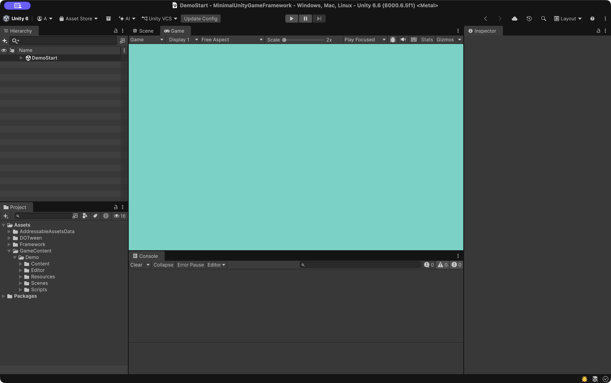
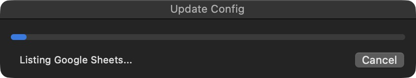
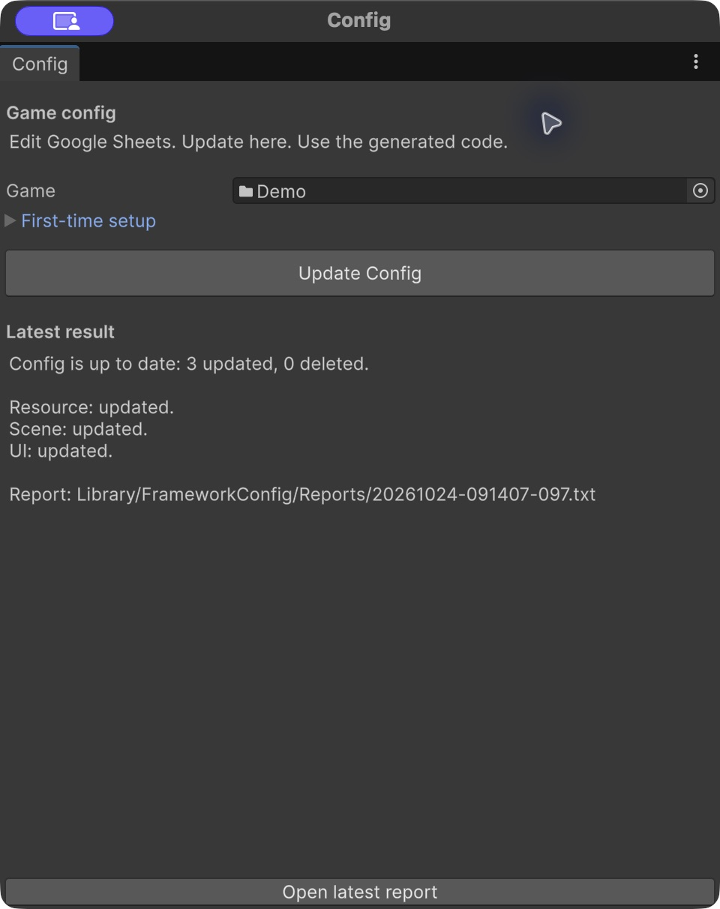
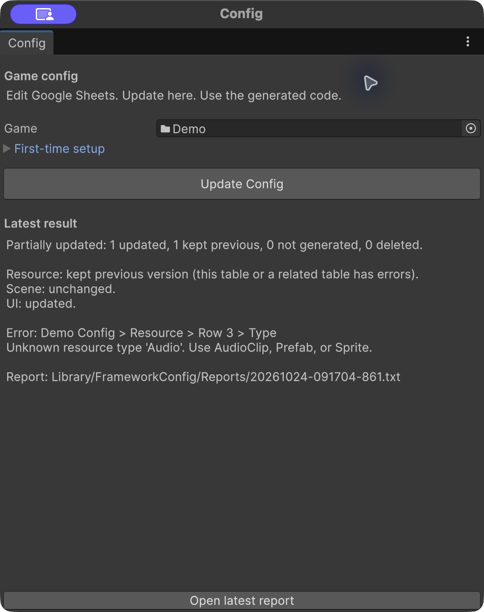
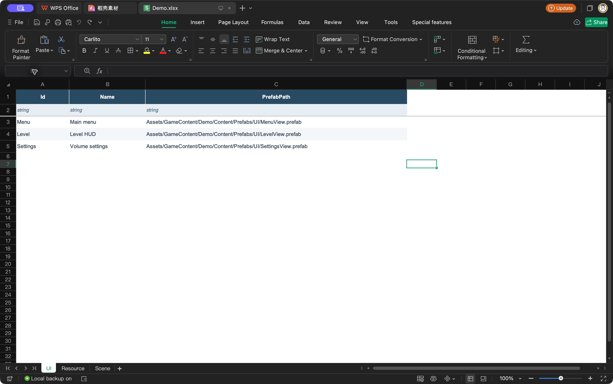

# Config tables

[Overview](../README.md) · [Quick start](quick-start.md) · [简体中文](config.zh-CN.md)

**Edit local Excel → Update Config → Use the generated data.** Google Sheets is optional. Both sources use the same format, validation and runtime API; each game has one active source.

The Demo includes `Editor/Tables/Source/Demo.xlsx` and generated configuration. Edit and run it locally without a Google account or credentials.

<a id="daily-workflow"></a>

## 01 Daily workflow

1. Edit and save the `.xlsx` workbooks in your configuration folder, or edit Google Sheets if that is your active source.
2. On the left side of Unity's top toolbar, click **Update Config**.
3. Wait for the progress window to close, then read the result. Fix reported errors in the source table or Unity and update again.

The toolbar uses the last game selected on this computer for this project. If no game is selected or its source settings are incomplete, it opens the Config dialog. Use **Framework → Config** to change games or edit settings.



Each update reads the current contents of the active source and writes only generated outputs whose contents have changed.

There is no completed-table selection or extra publish step. A valid row can be imported while someone is still editing it, so agree with teammates before importing an unfinished change.

<a id="read-the-result"></a>

### 1.1 Read the result

The native progress window stays open while Unity reads, checks and applies tables. You can **Cancel** before changes are applied; cancellation leaves this update's table changes unapplied.

After progress closes, a result dialog shows **success**, **partial update** or **failure**. Use **Open report** for details. If generated C# triggers compilation, the result appears after compilation; you do not need to update again to see it.

Valid tables update; an invalid table keeps its last successful version. Fix its reported error and update again.

<details>
<summary>See progress and result examples</summary>

The same progress window is used for both sources. This example shows a Google Sheets update:



These examples use the Demo tables. **Successful update:** all tables passed validation and their current versions are applied.



**Partial update:** valid tables update; an invalid table keeps its last successful version. Read the table's error, fix it and update again.



</details>

<a id="first-time-setup"></a>

## 02 First-time setup

Follow [Config setup](config-setup.md#01-first-time-setup) to create a local workbook and select its folder in Unity. Use the UI table from Quick start or the Item example below as your first table.

<a id="add-a-table"></a>

## 03 Add a table

This **Item** example is for ordinary game data. Create or open a `.xlsx` workbook directly inside your source folder, or open your connected workbook if Google Sheets is your active source. Add an **Item** sheet, enter these three rows from A1, then save. For a first connection, follow [Config setup](config-setup.md#01-first-time-setup) using this table.

| Id | Name | Price |
| --- | --- | --- |
| string | string | int |
| Potion | Small potion | 20 |

Check that **MyGame** is selected in **Framework → Config**, then click **Update Config** on the left side of Unity's top toolbar. Wait for the result and any compilation. If you just updated during first-time setup, you can skip this step.

**Success:** `Assets/GameContent/MyGame/Scripts/Generated/ItemTable.g.cs` exists and the result reports the Item table. Continue below to load and read it.

<a id="read-a-table"></a>

## 04 Read a table

If you have finished Quick start, open **MyGameEntry.cs** and add this code inside `Start()`, after its existing `GameConfig.LoadAndRegister()` call. Keep that one call; do not add another.

No startup script yet? Follow the [Core entry steps](core.md#01-set-it-up). After the `GameCore.IsReady` check passes, call `MyGame.GameConfig.LoadAndRegister()` once, then run the query below:

```csharp
var potion = MyGame.ItemTable.Get("Potion");
UnityEngine.Debug.Log(potion.Price);

foreach (var item in MyGame.ItemTable.All)
{
    UnityEngine.Debug.Log(item.Name);
}
```

Save the script, wait for compilation, then run your entry scene. **Console should print `20`, then `Small potion`.** Change the price to 30 in the table, save, update configuration and run again: it should now print 30.

**ItemTable** looks up rows; **ItemConfig** represents one row. `Get` throws if the ID does not exist; use `TryGet(id, out var row)` when absence is expected. Reading before loading is an error.

`GameConfig.LoadAndRegister()` loads local table data and registers UI and scene IDs. Resource modules still need explicit registration and loading; follow [Resources](resources.md) before using `main.Cue`.

<a id="table-format"></a>

## 05 Table format

Use one tab per table. Table names must be unique across all workbooks in the selected folder.

| Spreadsheet row | Content |
| --- | --- |
| 1 | Field names, with `Id` first |
| 2 | Field types: `string`, `int`, `float`, `bool`, or `ref:TableName` |
| 3 onward | Data; each `Id` is non-empty and unique within the table |

The Demo.xlsx **UI** sheet, shown here in WPS, demonstrates this layout: field names in row 1, types in row 2, and data from row 3. The ordinary-data example above uses Item.



`Id` must be `string` or `int`. For table and field names, use English letters, digits and underscores; do not start with a digit or use a C# keyword. Enter literal values, with `true` / `false` for booleans and a dot for decimals. Formulas are rejected, including formulas with cached results; paste values before importing. `ref:Item` means that cell must contain an existing Item ID.

<a id="ui-resources-and-scenes"></a>

### 5.1 UI, resources and scenes

These tables use fixed headers. Follow the matching guide:

| Table | Generated entry | Guide |
| --- | --- | --- |
| UI | `UIName.Shop` | [Add a window](ui-tables.md) |
| Resource | `main.Cue` | [Add resources](resource-tables.md) |
| Scene | `SceneName.Level01` | [Add a scene](scenes.md) |

All fields in these tables use `string`. Their `Name` column is for people and generates no field; an ordinary table's Name remains data. For IDs and resource module names, use English letters, digits and underscores; do not start with a digit or use a C# keyword. Asset paths start at `Assets/`.

<details>
<summary>Validation, partial updates and generated files</summary>

A missing UI prefab produces a warning, so its ID can be prepared before the prefab exists. Player builds require you to finish the prefab or remove its placeholder row and update config. Opening that UI cannot succeed until the prefab is ready and you update config again. A wrong asset type, invalid UIBase component setup or unusable Addressables entry is an error. Missing Resource or Scene assets are errors in this version.

Each table updates as a unit. An invalid table keeps its last successful code and data; on the first import it has no older version to keep. If a new table depends on a rejected change through `ref:TableName`, the dependent change also stays back. The final combination must have valid references. This does not restore a Unity asset someone deleted. Retained tables are checked against local assets too; an unusable retained resource or scene stops the update.

The result can therefore contain both updated and retained tables. An unreadable source folder stops the update; Google authentication or folder-listing failures do too. Read the report before committing; successful validation checks structure and references, not whether the game design is finished.

Generated outputs belong to the selected game:

```text
Assets/GameContent/MyGame/
├── Editor/
│   ├── ConfigSource.json         Source, folder and namespace
│   └── Tables/
│       ├── Source/              Editable local .xlsx workbooks
│       └── Generated/           CSV snapshots and applied manifest
├── Scripts/Generated/           C# tables, row types and registration
└── Resources/Config/MyGame/     Local JSON data (namespace folder)
```

Treat generated CSV, C# and JSON as read-only. Commit them together with the manifest, source settings, local source workbooks and Unity meta files so teammates can run the same version without source access. The manifest records the source and applied versions. Local import reports stay under `Library/FrameworkConfig/Reports/`, outside Git.

Edit or resolve conflicts in the active source, then run **Update Config** again; do not combine generated files by hand. Renaming or deleting fields, tables, IDs or modules can break handwritten C# callers. Fix those compile errors after generation. Moving an asset also requires updating its path in the source table and importing again.

</details>

Small gameplay values can stay in the Inspector or your own ScriptableObjects. Use tables when many rows share a structure. Dedicated text/localization and sound-playback configuration are deferred; AudioClip resource registration is available now.

Next: [UI](ui.md) · [Resources](resources.md) · [Scenes](scenes.md) · [Build](build.md)
