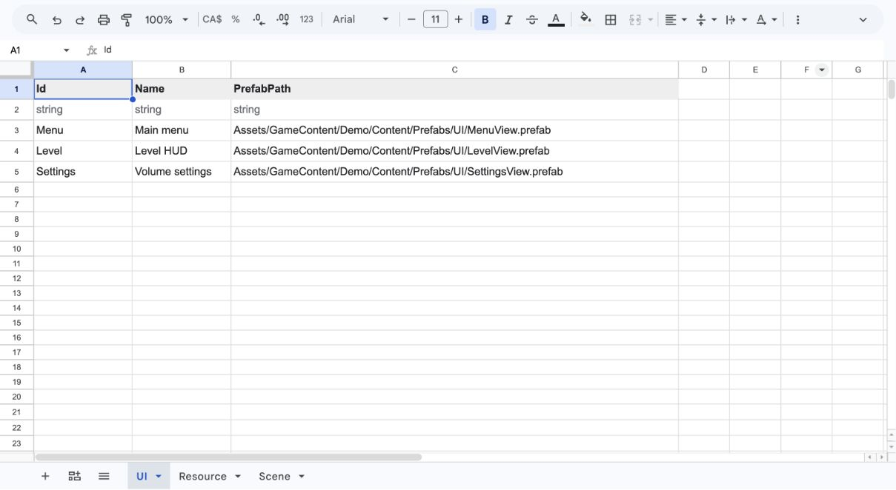

# 配置表

[总览](../README.zh-CN.md) · [快速开始](quick-start.zh-CN.md) · [English](config.md)

**编辑 Google Sheets → Update Config → 使用生成的数据。** 编辑器下载并校验表格；游戏读取本地生成文件，玩家不需要连接 Google。

仓库中的 Demo 已附带生成配置。运行它不需要 Google 账号、凭据或网络。需要修改表格时，再按下方步骤连接自己的来源。

## 日常操作

1. 编辑配置文件夹中的 Google Sheets 工作表。
2. 在 Unity 打开 **Framework → Config**，选择自己的游戏，点击 **Update Config**，等待编译完成。
3. 按下方说明查看结果。根据报告修正 Sheets 或 Unity 中的问题，再点击 **Update Config**。

每次更新都会读取 Google Sheets 中当前的表格内容，只写入内容有变化的生成文件。

不需要选择“已完成的表”，也没有额外发布步骤。工具可能导入别人仍在编辑、但结构已合法的内容；导入未完成的改动前，先与组员沟通。

### 查看结果

有效表更新，出错的表保留上次成功版本。按报告修正错误后再更新。

<details>
<summary>查看成功与部分更新示例</summary>

以下截图使用 Demo 表。**更新成功：** 所有表通过校验，当前版本已生效。


**部分更新：** 有效表更新，出错的表保留上次成功版本。查看该表的错误说明，修正后再更新。


</details>

## 首次设置

按[配置接入](config-setup.zh-CN.md#首次设置)准备 Google 访问权限并连接 Unity。第一张表可以直接使用快速开始中的 UI 表，或下方的 Item 示例。

## 添加一张表

这个 **Item** 示例用于普通游戏数据。首次连接时，按[配置接入](config-setup.zh-CN.md#首次设置)操作，在第 6 步输入下方内容；Unity 已连接时，在配置文件夹直接包含的工作簿中使用名为 **Item** 的标签。从 A1 输入以下三行：

| Id | Name | Price |
| --- | --- | --- |
| string | string | int |
| Potion | Small potion | 20 |

在 Unity 打开 **Framework → Config**，选择 **MyGame**，点击 **Update Config**，等待编译完成。首次设置最后一步的更新也完成了这一步。

**成功标志：** 出现 `Assets/GameContent/MyGame/Scripts/Generated/ItemTable.g.cs`，结果报告中包含 Item 表。接着按下方示例加载和读取。

## 读取一张表

在游戏启动代码中，**Core 就绪后、打开 UI 或切换场景前**加载生成配置，每个 Core 生命周期执行一次：

```csharp
// In startup, after GameCore.IsReady:
MyGame.GameConfig.LoadAndRegister();

var potion = MyGame.ItemTable.Get("Potion");
UnityEngine.Debug.Log(potion.Price);

foreach (var item in MyGame.ItemTable.All)
{
    UnityEngine.Debug.Log(item.Name);
}
```

标签 **Item** 生成查询入口 **ItemTable** 和行类型 **ItemConfig**。ID 不存在时 `Get` 会抛出异常；允许查询不到的场合使用 `TryGet(id, out var row)`。未加载就读取也会报错。

`GameConfig.LoadAndRegister()` 加载本地表数据，并登记 UI 和场景 ID。资源模块仍需显式登记和加载；使用 `main.Cue` 前，按[资源教程](resources.zh-CN.md)完成这些步骤。

## 表格格式

一个标签对应一张表。所选文件夹内所有工作簿的表名必须唯一。

| 工作表行号 | 内容 |
| --- | --- |
| 第 1 行 | 字段名，第一列必须是 `Id` |
| 第 2 行 | 字段类型：`string`、`int`、`float`、`bool` 或 `ref:TableName` |
| 第 3 行起 | 数据；每个 `Id` 非空，且在本表内唯一 |

Demo 的 **UI** 标签展示了这一布局：第 1 行是字段名，第 2 行是类型，第 3 行起是数据。上方“添加一张表”使用的是普通数据 Item 示例。



`Id` 类型必须为 `string` 或 `int`。表名和字段名使用 ASCII 字符组成的合法 C# 标识符。直接输入值，布尔值用 `true` / `false`，小数用英文句点；当前版本不支持公式。`ref:Item` 表示该格必须填写一个存在的 Item ID。

### UI、资源与场景

这三张表使用固定表头，按对应教程填写：

| 表 | 生成入口 | 教程 |
| --- | --- | --- |
| UI | `UIName.Shop` | [添加窗口](ui-tables.zh-CN.md) |
| Resource | `main.Cue` | [添加资源](resource-tables.zh-CN.md) |
| Scene | `SceneName.Level01` | [添加场景](scenes.zh-CN.md) |

这三张表的字段类型均为 `string`。`Name` 只供人阅读，不生成字段；普通表的 Name 仍是数据字段。ID 和资源模块名使用 ASCII 字符组成的合法 C# 标识符，资产路径从 `Assets/` 开始。

<details>
<summary>校验、部分更新与生成文件</summary>

UI 预制体缺失时给出警告，因此可以先准备 ID；Player 构建前必须补齐资产或删除占位行，再更新配置。预制体就绪并再次更新配置前，该 UI 无法正常打开。资产类型错误、UIBase 组件设置不合法或 Addressables 条目不可用属于错误。当前版本中，Resource 或 Scene 资产缺失也属于错误。

每张表整体更新。错误表保留上次成功生成的代码和数据；首次导入失败时，没有旧版可保留。如果新表通过 `ref:TableName` 依赖被拒绝的改动，其变更也会保留旧版，直到最终组合中的引用全部有效。这不能恢复被删除的 Unity 资产。保留的旧表也会检查本地资产；旧资源或场景已经不可用时，本次更新停止。

因此，一次结果可能同时包含已更新和已保留的表。身份验证失败或无法列出文件夹内容时会停止更新。提交前先看报告；校验检查结构与引用，不判断玩法设计是否已经完成。

生成内容归所选游戏所有：

```text
Assets/GameContent/MyGame/
├── Editor/
│   ├── ConfigSource.json         文件夹 ID 与命名空间
│   └── Tables/Generated/         CSV 快照与生效清单
├── Scripts/Generated/           C# 表、行类型与登记代码
└── Resources/Config/MyGame/     本地 JSON 数据（命名空间目录）
```

把生成的 CSV、C# 和 JSON 当作只读文件。将它们与生效清单、来源设置和 Unity meta 文件一起提交，组员无需云端权限也能运行同一版本。清单记录来源与实际生效版本。本机导入报告保存在 `Library/FrameworkConfig/Reports/`，不进入 Git。

在 Google Sheets 来源中编辑或解决冲突，再点击 **Update Config**，不要手工拼接生成文件。重命名或删除字段、表、ID、模块可能让手写 C# 调用无法编译，生成后需要修正调用。移动资产后，也要更新 Sheets 中的路径并重新导入。

</details>

少量玩法参数可以继续用 Inspector 或自己的 ScriptableObject；大量同结构数据再考虑表格。专门的文本／本地化和声音播放配置暂缓，当前已支持 AudioClip 资源登记。

下一步：[UI](ui.zh-CN.md) · [资源](resources.zh-CN.md) · [场景](scenes.zh-CN.md) · [构建](build.zh-CN.md)
