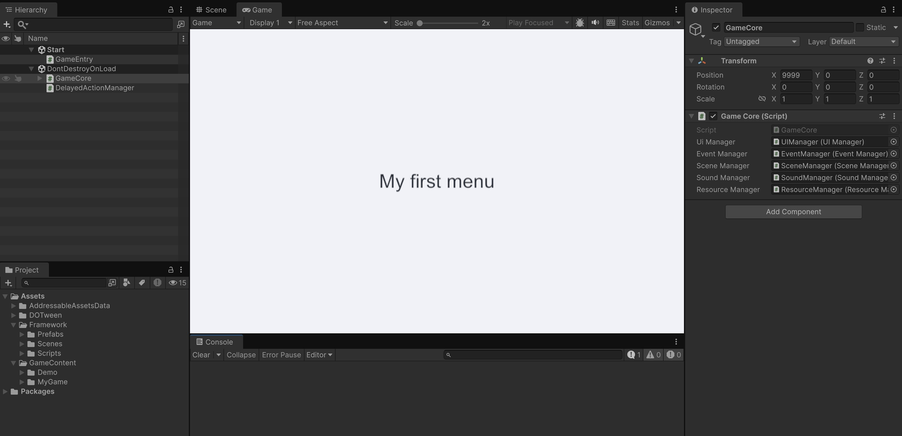

# 开始使用

[框架总览](../README.zh-CN.md) · [构建](build.zh-CN.md) · [English](quick-start.md)

**运行 Demo，再做第一个自己的窗口。** 准备好 Unity Hub、Unity 6.6（6000.6.5f1）和 C# 编辑器，会一点 Unity 基本操作即可。

本页跟随 **main 预览版**。固定的 SO 版本请使用 [v0.2.0 教程](https://github.com/AngusK97/MinimalUnityGameFramework/blob/v0.2.0/docs/quick-start.zh-CN.md)。

## 运行 Demo

1. [下载 main 预览版（ZIP）](https://github.com/AngusK97/MinimalUnityGameFramework/archive/refs/heads/main.zip)并解压，在 Unity Hub 打开包含 Assets、Packages、ProjectSettings 的目录，等待导入和编译完成。
2. 打开 **Window → Asset Management → Addressables → Groups**，把 **Play Mode Script** 设为 **Use Asset Database (fastest)**。
3. 打开 `Assets/GameContent/Demo/Scenes/DemoStart.unity`，点击 Play，再点 **Start**，用 **WASD / 方向键**移动到 GOAL。
4. **Play again** 重开，**Menu** 返回；**Settings / Escape** 打开音量设置，**Done / Escape** 保存并关闭。
5. 再点一次 Play 退出运行，然后继续制作。

**成功标志：** MINIMAL LOOP 菜单和关卡正常运行。设置只暂停 Demo 的移动和计时。Demo 已包含生成配置，运行不需要 Google 账号、密钥或网络。

## 创建第一个窗口

第一次先保留下面的名字，顺着做完：**视图 → Prefab → Google Sheets → Update Config → 启动入口**。

### 1. 创建视图

在 `Assets/GameContent/MyGame/` 下创建这些目录：

```text
Scenes/
Content/Prefabs/UI/
Editor/Tables/
Scripts/
```

在 Scripts 选择 **Create → Scripting → MonoBehaviour Script**，命名 **MyMenuView**。把整个文件替换为下面的代码，保存后等待编译：

```csharp
using UI;
using UnityEngine;

namespace MyGame
{
    public sealed class MyMenuView : UIBase
    {
        protected override void OnShow()
        {
            Debug.Log("MyGame menu opened.", this);
        }
    }
}
```

### 2. 保存 UI 预制体

1. 用 **File → New Scene** 创建临时空场景，再选择 **GameObject → UI → Panel**。
2. 把 Panel 改名 **MyMenuView**，将 MyMenuView.cs 拖进它的 Inspector；上面只保留一个 UIBase 派生组件。
3. 选中 Panel，选择 **GameObject → UI → Legacy → Text**，文字设为 `My first menu`，调整到 Panel 内可见的位置。
4. 将 Hierarchy 中的 Panel 拖到 `MyGame/Content/Prefabs/UI/`，保存为 **MyMenuView.prefab**。保存 Panel，不是外层 Canvas；相机和 EventSystem 也不放进去，运行时由 Core 提供。
5. 在 **Project 选中已保存的 MyMenuView.prefab**，勾选 Inspector 顶部的 **Addressable**，保留默认地址。

### 3. 连接并更新 UI 配置表

1. 为 **MyGame** 完成[配置：首次设置](config.zh-CN.md#首次设置)。这会准备共享 Drive 文件夹与本机凭据连接，只需做一次。
2. 在该文件夹直接包含的工作簿中，新建名为 **UI** 的标签，从 A1 输入：

| Id | Name | PrefabPath |
| --- | --- | --- |
| string | string | string |
| Menu | My first menu | Assets/GameContent/MyGame/Content/Prefabs/UI/MyMenuView.prefab |

3. 在 Unity 打开 **Framework → Config**，选择 **MyGame**，点击 **Update Config**，等待编译完成。
4. 确认 UI 表已更新，且出现 `MyGame/Scripts/Generated/UIName.g.cs`。

**先更新再继续：** 下一步脚本需要 GameConfig 和 UIName 已存在。后续修改见 [UI 配置表](ui-tables.zh-CN.md)。

### 4. 添加游戏入口

在 Scripts 用同一个脚本菜单创建 **MyGameEntry.cs**，把整个文件替换为：

```csharp
using Core;
using UI;
using UnityEngine;

namespace MyGame
{
    public sealed class MyGameEntry : MonoBehaviour
    {
        private void Start()
        {
            if (!GameCore.IsReady)
            {
                Debug.LogError("Add the shared GameCore prefab to the entry scene.", this);
                return;
            }

            GameConfig.LoadAndRegister();

            GameCore.UI.OpenUI(UILayer.First, UIName.Menu, callback: view =>
            {
                if (view == null)
                {
                    Debug.LogError("Menu failed to open. Check the earlier Console errors.");
                }
            });
        }
    }
}
```

1. 新建空场景，移除默认 Camera/Light。Prefab 保存好后，临时制作场景可以不保存。
2. 保存为 `Assets/GameContent/MyGame/Scenes/Start.unity`。
3. 将 [GameCore.prefab](../Assets/Framework/Prefabs/GameCore.prefab) 拖入 Hierarchy，保持为根对象。它已带有 Canvas 层、EventSystem 和 AudioListener。
4. 创建空的根对象 **GameEntry**，挂上 **MyGameEntry.cs**。它和 GameCore 并排，互相不包含。
5. 保存并 Play。

**成功标志：** 看到 `My first menu`，Console 输出 `MyGame menu opened.`，没有红色错误。Noooooice 🎉



没成功时，检查 GameCore、MyGameEntry 是否挂好，以及 UI 表的生成状态。更多检查见[构建与排错](build.zh-CN.md)。

## 删除 Demo

在 Unity Project 窗口删除 `Assets/GameContent/Demo`。从磁盘删除时先关 Unity，再删除**目录及 Demo.meta**。保留 GameContent、`.gitkeep`、公共框架和自己的游戏。

再次运行自己的 Start.unity。自己的游戏应使用自己的标识与资产，不引用 Demo 命名空间、DemoGame 或 Demo 资产。公共 `Assets/Framework/Scenes/InitScene.unity` 只准备服务，不会打开菜单。

## 下一步

[新增 UI](ui-tables.zh-CN.md) · [窗口生命周期](ui.zh-CN.md) · [构建游戏](build.zh-CN.md)
