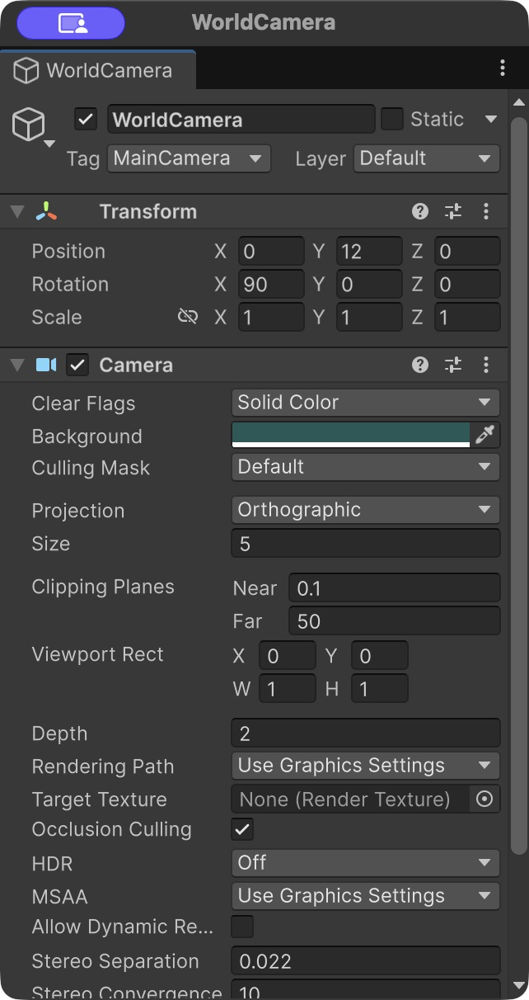

# 场景转场

[框架总览](../README.zh-CN.md) · [开始使用](quick-start.zh-CN.md) · [English](scenes.md)

用遮罩盖住画面，加载新关卡、关闭旧 UI，等你准备好新场景后再显示出来。

<a id="试试看"></a>

## 01 试试看

先完成[第一个窗口](quick-start.zh-CN.md#02-创建第一个窗口)。接下来给已有的 **MyMenuView.prefab** 加一个进入关卡的按钮，继续用 **MyGameEntry.cs** 加载配置。

1. 创建场景，放入相机，以及一个位于 **Default** 层、能被相机看到的物体。将相机的 **Depth 设为 2**、**Culling Mask 设为 Default**，并移除它的 **AudioListener**，Core 已经有一个。Core 的背景相机 Depth 为 1，如果保留新相机的默认 Depth，关卡画面会被背景盖住。保存为 `Assets/GameContent/MyGame/Content/Scenes/Level01.unity`，再到 Project 选中这个场景资产，勾选 Inspector 中的 **Addressable**。

<details>
<summary>查看相机设置（Demo 实景）</summary>



图中是 Demo 的 WorldCamera。本例只需参考 Depth 和 Culling Mask，其他参数按自己的场景调整。

</details>

2. 打开 `Assets/GameContent/MyGame/Editor/Tables/Source/MyGame.xlsx`；如果已选 Google Sheets，就打开当前使用的云端工作簿。添加 **Scene** 工作表，从 A1 开始填入下面的内容。如果已经有 Scene 表，保留前两行，只添加 **Level01** 这一行数据。保留原来的 UI 表。

| Id | Name | ScenePath |
| --- | --- | --- |
| string | string | string |
| Level01 | First level | Assets/GameContent/MyGame/Content/Scenes/Level01.unity |

3. 保存本地工作簿（Google Sheets 则等云端保存完成），在 **Framework → Config** 中选择 **MyGame**，点击 **Update Config**，等待更新结果和编译完成。这会生成 `SceneName.Level01 = "Level01"`。已有的 **MyGameEntry.cs** 会在 Core 就绪后调用 `GameConfig.LoadAndRegister()`，将这个 ID 与 Addressables 地址关联起来，保留这一处调用即可。
4. 打开 `Assets/GameContent/MyGame/Scripts/MyMenuView.cs`，在文件顶部添加 `using Core;`，保留 `using UnityEngine;`。将下面的方法放进 **MyMenuView 类内部**，与 `OnShow()` 并列：

```csharp
public void GoToLevel()
{
    GameCore.Scene.TryTransition(
        MyGame.SceneName.Level01,
        completed: (succeeded, error) =>
        {
            if (!succeeded)
            {
                Debug.LogWarning(error);
            }
        });
}
```

5. 保存脚本，等待编译完成。双击 `Assets/GameContent/MyGame/Content/Prefabs/UI/MyMenuView.prefab` 进入 Prefab Mode，选中根对象，通过 **GameObject → UI → Legacy → Button** 添加按钮。把按钮放到能看见的位置，将文字改为 **Go to level**。在 Button 的 **On Click ()** 中点击 **+**，把 **预制体 Hierarchy 中的 MyMenuView 根对象**拖入对象栏，选择 **MyMenuView → GoToLevel()**，然后保存预制体并退出 Prefab Mode。
6. 打开 `Assets/GameContent/MyGame/Scenes/Start.unity`，按 Play，再点击菜单中的 **Go to level**。从这个入口开始运行，这样点击按钮时，Core 和配置都已经准备好了。

**预期结果：** 点击一次按钮后，遮罩出现，旧窗口关闭，然后显示 Level01 中的物体。Single 模式会用新场景替换旧场景，Core 则会保留下来。在 Editor 外测试前，先为 Player 的目标平台构建 Addressables。如果加载失败，旧 UI 会保留，并显示 Retry 面板；错误原因可以在 Console 和面板中查看。

<a id="使用约定"></a>

## 02 使用约定

- `TryTransition` 和 `TryTransitionAddress` 返回 true，表示请求已被接受。如果正在转场，或请求无效，则返回 false，不会排队，并立即调用一次 `completed(false, error)`。所以上例中的回调既会处理请求被拒绝，也会处理转场开始后的失败。
- 只有加载成功后，才会关闭旧 UI。如果已经开始的转场失败，可以查看 `LastError`，然后使用 Retry 面板或 `RetryTransition()` 重试。被拒绝的请求不会创建重试操作。
- 将转场控制器放在常驻对象上，或使用静态方法。Single 模式会卸载旧场景，其中的回调目标也会被销毁。
- 在处理游戏输入时，自行检查 `IsTransitioning`。遮罩会挡住 UGUI 射线，但不会阻止键盘或手柄输入代码执行。

<details>
<summary>需要时再看：等待 HUD 和资源准备好</summary>

传入 `enterScene: scene => PrepareScene(scene)`，就可以让转场等待自己的准备工作。这个方法需要返回 `IEnumerator`，参数类型是 `UnityEngine.SceneManagement.Scene`（需要 `using System.Collections;`）。

准备协程会在场景激活、旧 UI 清理完成后执行，等它结束才会隐藏遮罩。你可以在这里等待资源和 HUD 的回调，也可以使用嵌套协程。如果协程抛出异常，这次转场就会失败。

Single 模式下，新场景激活后，旧场景已经被替换。此时即使准备工作失败，也无法恢复旧场景，但仍可通过错误面板重试。`RetryTransition()` 会重新加载场景并执行准备工作，不会回滚游戏进度。

timeScale=0 时，使用 realtime 等待，或轮询回调是否完成。框架的渐变动画不受时间缩放影响，但 `WaitForSeconds` 仍遵循 Unity 的时间规则。你启动的任务和持有的资源，需要在 finally / Dispose 中自行清理。

</details>

<details>
<summary>需要时再看：完成时机、生命周期与低层 API</summary>

转场请求被接受后，完成回调会等到遮罩隐藏、服务恢复空闲才执行。你可以在这个回调里发起下一次转场。请求被拒绝时，回调会同步执行，不会打断正在进行的转场。通知过程中如果抛出异常，会记录错误，但不改变转场结果；直接绑定到已销毁 Unity 对象的方法会被跳过。

框架不会自动重置游戏的暂停状态、卸载所有模块或停止所有音频，也不支持中途取消加载或回滚场景。禁用或销毁管理器时，每次转场只会完成一次收尾。如果加载结果在这之后才返回，失败时会释放句柄，成功时会保留新加载的活动场景。

`TryTransition(string)` 会按已登记的场景 ID 查找地址。遇到未知 ID 时，它会返回 false，不会把这个字符串当作 Addressables 地址来尝试加载。如果要直接传入 Addressables 地址，调用 `TryTransitionAddress(key, ...)`。旧版代码中直接传入字符串地址的地方，也要改用这个方法。

`LoadSceneAsync` / `UnloadSceneAsync` 不经过上面的转场流程，适合需要自行管理 Additive 加载、手动激活和句柄释放的代码。加载失败时，由调用者释放句柄；加载成功后，也由调用者负责卸载场景。同一次操作不要混用这两套方式。

</details>

下一步：[管理跨场景资源的加载和释放](resources.zh-CN.md)。
