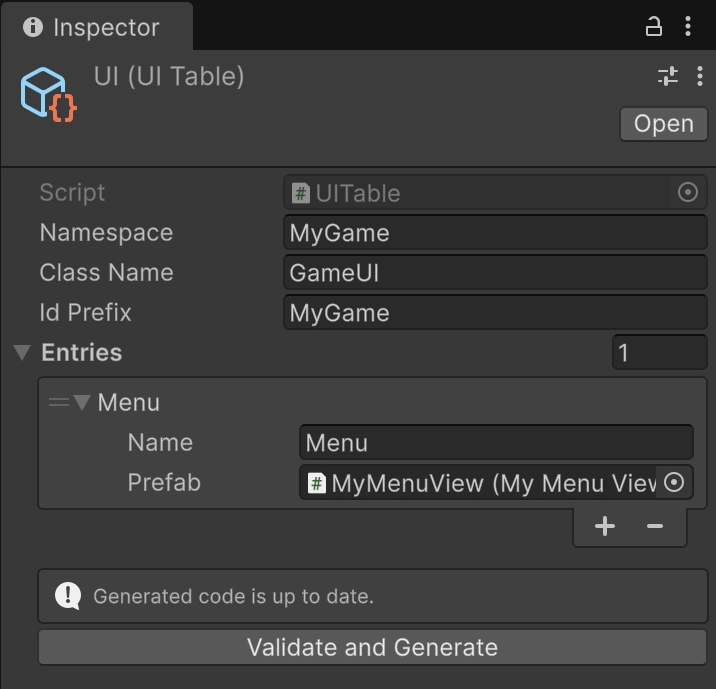

# UI tables

[Overview](../README.md) · [Quick start](quick-start.md) · [简体中文](ui-tables.zh-CN.md)

**Add your windows to a list in the Inspector, then click one button to give your code names it can use.**

## Create a table

1. In your game's `Editor/Tables/` folder, right-click **Create → Framework → UI Table**. Keep the default name **UI** (saved as UI.asset).
2. Select UI.asset. Expand **Entries** and click **+** to add a row. Fill the Inspector, then drag your saved prefab **from Project** into the Prefab field. Use the saved asset, not an object in Hierarchy:

| Field | Example |
| --- | --- |
| Namespace | `MyGame` |
| Class Name | `GameUI` |
| Id Prefix | `MyGame` |
| Entries → Name | `Menu` |
| Entries → Prefab | Your saved prefab's root UIBase-derived component |

3. Click **Validate and Generate**, then wait for compilation.
4. The status should read **Generated code is up to date.** The output is `MyGame/Scripts/Generated/GameUI.g.cs`.



*MyGame's UI table after generation: Menu references the saved MyMenuView prefab.*

Name is the code label, such as Menu; your player-facing title stays in the prefab. Use names without spaces. For MyGame from the [first-window tutorial](quick-start.md), the folders follow this rule:

```text
<game root>/Editor/Tables/UI.asset
<game root>/Scripts/Generated/<ClassName>.g.cs
```

Use the same Tables folder for future authoring tables; only the UI table tool is currently implemented.

## Use it

After Core is ready, call `MyGame.GameUI.RegisterAll()` **once per Core lifetime**. Open windows with the generated constants:

```csharp
// In game startup, after GameCore.IsReady:
MyGame.GameUI.RegisterAll();
GameCore.UI.OpenUI(UILayer.First, MyGame.GameUI.Menu);
```

Use `using Core; using UI;`. This assumes the table was generated before you wrote code referencing GameUI. The runtime ID is `MyGame.Menu`; the generator also records the prefab's actual Addressables address.

## Change a window

**Edit UI.asset → Generate → Wait for compilation → Use the constant.**

- Add a window: add its Name and Prefab, generate, then use `GameUI.NewName`.
- Move a prefab or change its address: preserve its meta, regenerate. Keeping Name/Id Prefix preserves the UI ID.
- Delete a row: generate, then fix references to the removed member.
- Commit the table, generated C# and their meta files together. Edit the table rather than generated code.

Runtime prefabs under `Assets/GameContent/` inherit the existing Addressables folder entry. You do not need to mark every descendant separately.

<details>
<summary>Validation, renaming and recovery</summary>

The exact source location is required. Namespace can be empty; use English C# identifiers for names. Namespace/Id Prefix may be dot-separated. Keywords, RegisterAll, class/member conflicts, duplicate names/prefabs, cross-table class/full-ID collisions and unavailable/non-unique addresses are rejected. A prefab must have one UIBase-derived component on its saved root; scene objects and child components are invalid. Its group must include it in the build and include addresses in the catalog.

Class Name changes: generate the new class first, update callers, then remove the old generated file/meta. Game root changes: move the table and existing output/meta together to the newly derived locations, then generate. The tool does not automatically delete old source files or parse all handwritten type names.

Changing Name/Id Prefix changes the runtime ID; migrate any stored IDs in your own saves/messages. Namespace changes require caller updates.

Generation preserves the old output on validation failure and refuses to overwrite handwritten files, another table's output or an edited generated body. Restore or move aside an edited output before regenerating. Identical content is not rewritten; CRLF/BOM checkouts are supported.

The table and tool are Editor-only. Player uses generated code and does not load the table. Generation is disabled during Play/compilation; Play uses the last generated version. A read-only Player prebuild check rejects missing/stale/edited output. A project with zero tables is valid.

</details>

Next: [UI](ui.md) for window behavior or [build](build.md) to package your game.
